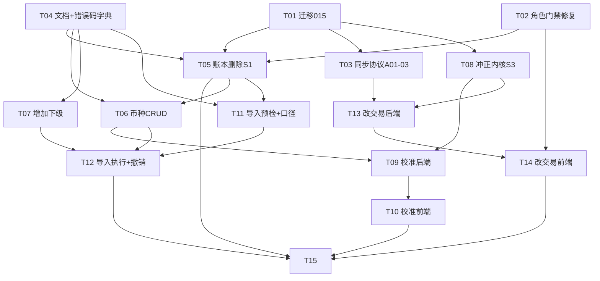

# FamBean 0.6.0（任务代号 0.5.2）增量系统设计

> **作者**：高见远（架构师）｜ **产品口径源**：`docs/0.6.0-prd.md`（§1.2 D-01~D-15、§2 C-01~C-07、§5 逐条 AC、§6.2 015 清单、§6.4 A-01~A-03、§7 S0~S6、§9 Q-02~Q-11）
> **文档状态**：**已交付**（2026-11-15，v0.6.0 已发布并打 tag；实现与设计的偏差均已按代码事实裁定并落档于交付记录）
> **现状权威源**：`AGENTS.md`（HEAD `d1e9252`，36 端点、迁移至 014、append-only、bean-check 铁律）
> **本文档地位**：架构设计唯一权威；所有设计均已逐一实读仓库代码验证（见 §10「与 PRD 的差异」）。
> **硬约束重申**：不输出 `balance`/`pad` 指令；append-only 绝不原地 UPDATE；金额定点十进制禁浮点；单个 015 迁移；不新增同步 op、不升协议版本；不引入新依赖包（前后端均无新增，见 §6）；本轮只交付本文档，不改代码。

---

## 1. 实现方案总览（按 PRD §7 的 S0~S6 切片）

技术栈**完全复用现有**：后端 Go 标准库 + `modernc.org/sqlite`（分层 `repository → service → handler → server/router`），前端 Vue 3 + Vite + Pinia（`api/routes.ts` → `api/client.ts` → `stores` → `views`，离线内核 `core/sync/`）。**零新增第三方依赖**。

### S0 · 公共底座（阻塞全部）

| 项 | 实现策略 | 现状依据（已实读验证） |
|---|---|---|
| 迁移 015 框架 | 在 `internal/db/migrate.go` 的 `migrations` 数组追加 `{"015_ledger_ops", migrate015}`，全部列用 `columnExists` 幂等保护（同 010/011 风格），索引 `IF NOT EXISTS`；迁移测试镜像 `migrate012_test.go` 结构 | `migrate.go:14-32` 迁移表、`ApplyMigrations:99-129` 幂等框架 |
| 角色门禁修复（D-14） | `frontend/src/stores/session.ts:45` 的 `isViewer` 改为从 `ledgers` 里按当前 `ledgerId` 查 `role === 'viewer'` 派生（正确写法参考 `LedgersView.vue`/`MembersView.vue` 的 role 读取）；`user.role` 恒空（`auth.go` Me() 返回 `Role:""`）不再作为来源 | `session.ts:45`、`middleware.go:197-200`（后端权威防线不动） |
| 默认账本回退修复（D-03/AC-1.6） | `middleware.go:229-238` 的 `ledgerIDFromRequest` 从「纯函数回退 `domain.DefaultLedgerID`」改为：有合法 `X-Ledger-Id` 用之；否则经 `svc` 查「该用户所属、`deleted_at IS NULL`、最小 id」账本；查不到 → 401/403 语义照旧。`repo.RoleOf` / `LedgerRole` 增加账本 `deleted_at IS NULL` 联查，软删账本一律 403 | `middleware.go:229-238`、`domain/models.go:12` |
| 导入账本上下文口径同步（D-12） | 删除 `middleware.go:165-171` 的 `/api/import/*` 豁免分支；`frontend/src/api/routes.ts:106-116` 的 `NO_LEDGER_PATHS` 移除 `'/api/import'`（保留 `'/api/db'`）；5 处口径注释同步（见 T11 文件清单） | `middleware.go:168`、`routes.ts:114` 已核实存在 |
| 同步协议登记项（A-01/A-02/A-03） | 见 §3.4；`applyUpdateEntity`（`service/sync.go:521-541`）增加 `transaction` 分支；`loadEntity`（`sync.go:150-176`）transaction payload 增 `reversed_by`；前端 `LocalTxn`（`core/sync/models.ts:39-48`）同步补字段；A-03 整条覆盖回归（`localStore.ts:232-234` 已是 `this.txns.set(key, entity)`，补 Memory/IndexedDB 双实现用例） | 已逐行核实与 PRD §6.4 一致 |
| S0 文档校订（D-13） | `AGENTS.md:147`、`README.md:26`、`README.md:32`（1.26→1.25.0）、`internal/export/beancount.go:217-218` 注释（该注释确实写「支持 close 后再 open 同名」，与 C-04 相反）；`README.md:7` 保留 | 已核实 |
| 稳定错误码字典 | `internal/domain/errors.go` 增补码常量（§5 字典）；前端 `frontend/src/api/errors.ts` 增「稳定码 → 中文文案」集中映射 `codeMessage()` | `errors.go:35-57` 现有码表 |

### S1 ★ 最小可交付切片 · 账本删除（#1）

- 后端：`DELETE /api/ledgers/{id}`（`router.go` 新增 methodSwitch）→ `service.DeleteLedger(userID, ledgerID)`：`requireOwner` → 除 owner 外成员数 >0 → `409 ledger_has_members`（body 带成员数与用户名列表）→ 该用户最后一个有效账本 → `409 last_ledger` → **先** `backup.Engine.Snapshot("pre-ledger-delete")`（VACUUM INTO，Q-07 结论：保留策略见 §7 Q-07）→ 单事务 `UPDATE ledgers SET deleted_at=…`；不写 sync_log（账本非同步实体）、不轮换 `instance_id`。
- 查询口径：`ListLedgersByUser`（`repository/ledger.go:23-49`）与 `LedgerByID`/`RoleOf` 增加 `l.deleted_at IS NULL`；`GET /api/ledgers` 行级附加 `member_count` / `account_count` / `transaction_count`（P1-03，确认弹窗直接用，不新增端点）。
- 前端：`LedgersView.vue` 删除入口（仅 owner 且成员门禁）、输入账本名确认词、`session.refreshLedgers()`（`session.ts:97-106` 已按列表顺序兜底首个=最小 id，配合服务端过滤软删后天然满足 AC-1.4）。
- 回归：`POST/PATCH /api/ledgers`（已交付）不动。

### S2 · 纯 CRUD 增强（#4 币种、#2 增加下级，可并行）

- **#4**：新增 `GET/POST /api/commodities`、`DELETE /api/commodities/{uuid}`；`ensureCommodityOn`（`repository/commodity.go:84-107`）改为 `WHERE deleted_at IS NULL`，且「仅存在软删行」时**静默跳过**（不重建、不写 sync_event，满足 AC-4.4）；`export/beancount.go:52` 的 commodities 查询加 `AND deleted_at IS NULL`；`CommodityPrecision` 同步过滤。前端 `CommoditiesView.vue` 由只读聚合升级为可增删。
- **#2**：`service.CreateAccount`（`service/account.go:80-127`）现对 `parent_uuid` **零校验**（已核实），补：父存在/同账本/同类型/未关闭/未删除，不传父级**不静默降级为根**（显式 `parent_uuid=""` 才是根）；新增账户名格式校验器（C-03，与 seed 命名约定一致）；前端 `AccountForm.vue` 增加「＋ 增加下级」预填父项、`CategoriesView.vue:154-186` 改为传 `parent_uuid`（冒号拼名兜底保留在 `core/accounts.ts:178-215`，其环容错测试不动）。

### S3 · 通用冲正 / 版本 / 审计内核

抽取 `repository/opening.go` 既有范式为可复用组件（**不改既有行为**，仅搬移+泛化）：

| 复用件 | 来源（已核实） | 015 后的新通用能力 |
|---|---|---|
| 冲正交易生成 | `insertReversalTx`（`opening.go:506-539`，同日期分录取负、`reversal_of=原 uuid`） | 泛化为 `insertReversalTxnTx(tx, ledgerID, src domain.Transaction, desc string) (revUUID string, revID int64, err error)`，opening 与 #5 共用 |
| 原交易标记 | `UPDATE transactions SET reversed_by=? WHERE … AND (reversed_by IS NULL OR '')`（`opening.go:195-206`）+ `RowsAffected=0` 并发保护 | 同款，供 S4/S6 |

禁止复用 `client_request_id`（`repository/transaction.go:324-326` 注释与 AGENTS §7 L207 口径一致）；#5 幂等改由 D-15 判定兜底（Q-06，见 §7）。**老板已裁定砍掉版本链（2026-11-14）：不再需要版本链遍历/latest 解析组件**。

### S4 · 余额校准（#3）

- 新端点 `GET/POST /api/accounts/{uuid}/balance`（Q-03 命名，与 `/opening` 同款形态）。
- 日初语义：累计 = `postings JOIN transactions WHERE date < D`（**不含 D 当日**，C-01）；新增 repo 方法 `ComputeBalancesBefore(ledgerID, beforeDate)`（Q-08：抽取 `ComputeBalances` 的聚合 SQL 为带日期上界的私有实现，`ComputeBalances` 原样保留——单一口径源）。
- 落账：日期 `D-1` 且 `>= max(账户 open_date, 账本期初日期)`（裁定 2），区间为空 → `400 balance_date_too_early` 不静默前移；分录 = 各币种差额 + `Equity:Opening-Balances` 对手（`ensureOpeningEquityTx` 复用；Q-11：关闭场景换独立码 `opening_equity_closed` + 校准文案）；`balance_key = "balance:{account_uuid}:v{version}"`（部分唯一索引，同 012 的 `idx_txn_opening_key` 款式）、`balance_date = D`；**不写** `opening_account_uuid` → 天然不被 `RebuildAllOpenings`（按 `opening_account_uuid` 筛，`opening.go:300-313`）重建、不被 `loadOpeningRecord`（`:547-558`）误读、**会**被 `EarliestNonOpeningTxnDate`（`:91-106`）计入（AC-3.4 明确要求计入以防 opening_date 上界算错）。同一 (账户,D) 再设 → 冲正旧校准 + 新建（版本递增），复用 S3 内核。
- 期初/校准/冲正交易一律禁走编辑入口（AC-5.6），`can_edit=false`。

### S5 · 导入到当前账本（#6）

- **解析器扩展（关键前置，PRD 未明说）**：`internal/beancount/beancount.go` 目前把 `pad`/`balance` 直接当「不支持的指令」塞进 `Errors`（`:87-88,144-145` 已核实），**拿不到行号/账户/目标金额的结构化数据**，AC-6.6 的逐条差额与 AC-6.7 的展开都无从做起。设计：`Parse` 新增 `PadBalances []PadBalance` 结构化收集（`{Line, Type: pad|balance, Account, Amount(仅 balance), Date}`），`pad`/`balance` 不再进 `Errors`；是否拒绝由调用方按 `target` 决定。其余严格子集与「全量错误行号」行为不变。
- **预检**（扩展现有 `POST /api/import/beancount/preview`，body 增 `target`）：`target=current`（默认）遇 pad/balance → `valid=false` + `code=import_pad_balance_unsupported` + 逐条 `{行号,类型,账户,目标金额,按当前账本重算的累计,差额}`（差额重算走 `ComputeBalancesBefore`，Q-08）+ 两条出路文案；冲突清单（新增账户/复用/新增交易/跳过重复/新增币种/错误行号，AC-6.2）。`target=new`：pad 展开为普通 `*` 交易（差额 = 目标 − 截至断言日初累计，flag 用 `*` 不用 `P`，Q-09/裁定 3；审计标记见 §7 Q-09 尾注）、balance 转导入后自检（断言不落库不导出）。
- **执行**（扩展现有 `POST /api/import/beancount`）：单一大事务；同名账户按 name 复用（类型/`commodity_restriction`/已关闭冲突 → `409 import_account_conflict` 整体拒绝，C-04）；每笔 `client_request_id = "import:"+sha256(规范化交易文本)`（复用 013 部分唯一索引，零新增索引）；**修复 `repository/import.go:160` 忽略 `inserted`**（已核实 `txnID, _, err := insertTransactionRowTx(...)`）：`if !inserted { skipped++; continue }`；逐笔按 commodity 分组 `Σ amount==0`（不平 → `409 import_unbalanced` 带行号差额）；每行写 `import_batch_id`（015 列）；`sync_log op=create`；不轮换 `instance_id`。
- **批次撤销**：`POST /api/import/beancount/undo {import_batch_id}`：单事务硬删本批 `postings→transactions→prices`（FK 顺序安全：`postings.transaction_id` CASCADE；先删分录后删交易行），批次新建的账户/币种按 §10-5 **硬删行** + `sync_log op=delete` 一并删除；复用账户不动。已知取舍见 §10-5。
- 前端：`ImportView.vue` 目标账本显示、target 切换、预检冲突清单渲染、撤销入口。

### S6 · 修改交易（#5，最后上线）

- `PATCH /api/transactions/{uuid}`（D-07 裁定 1 + D-15 裁定 6，**2026-11-14 老板裁定修订：砍掉版本链，见 §10-1**），核心事务三步（§4 时序图 1）：
  1. `UPDATE transactions SET reversed_by=<冲正 uuid>`（原交易**保留不软删**，继续参与导出——`export/beancount.go:110-111` 以 `deleted_at IS NULL` 过滤，已核实软删会破坏净效果，故不软删）→ `sync_log op=update`；
  2. 冲正交易（分录取负、`reversal_of=原 uuid`，复用 S3 内核）→ `op=create`；
  3. 改后交易（新 uuid 的普通交易、`created_by=uid`）→ `op=create`。
- 权限（服务端权威，`PATCH` 独立校验防绕过）：owner 全账本（已冲正原交易除外）；`created_by==uid` 且非 viewer；其他 editor → `403 txn_edit_forbidden`；`created_by=0` 由 owner 兜底。编辑禁止清单（AC-5.6）：`opening_account_uuid != ''` ∨ `balance_key != ''` ∨ `reversal_of != ''` → `409 txn_not_editable`；`reversed_by != ''` → `409 txn_already_reversed`（**判定优先于角色**，owner 亦不可改；响应不带 `latest_uuid`，客户端刷新流水自行定位改后交易，Q-06）。
- `can_edit` 只加在在线 `TransactionView`（`service/transaction.go:26-34` 已核实仅有 `created_by_name`），服务端按请求用户算，含 D-15 判定；**不进** sync/pull 实体（`loadEntity` 无 userID 上下文）。`can_restore` 同理加在 `TrashItemView`（Q-04）。
- 权限收紧（D-08/AC-5.8）：`ListDeletedTransactions` / `RestoreTransaction` / `DeleteTransaction` 三个签名**加 userID**（`service/transaction.go:275/313/332` 已核实现签名无 userID），handler 从 `auth.UserID(r.Context())` 注入；viewer 仍可看回收站但 `can_restore=false`。
- 呈现（砍掉版本链后）：`TransactionView` 增补 `reversed_by`/`reversal_of`（additive）驱动列表「已冲正/冲正」徽章（徽章只依赖这两个字段，保留）；原交易详情不再提供「前往最新版本」跳转、**无版本历史时间线端点**——用户在流水中自行定位改后交易（改后交易是普通交易，按日期/摘要可见）；`reversal_of` 仍可逐层回溯「原交易 → 其冲正」方向。
- A-01/A-02/A-03 随 S0 已落地，S6 验收联调。

### 收口

全量回归：`BEAN_CHECK_STRICT=1` bean-check、迁移 `rehearse`、CI 用例数下限、版本三处一致 `0.6.0`（tag / `CHANGELOG.md` / `frontend/package.json` + README 镜像）、`AGENTS.md` §7 扩表（36→44 条）+ §9 回写、CHANGELOG 破坏性变更标注（导入目标 / 交易权限）。

---

## 2. 015 迁移最终清单（单个迁移，名称 `015_ledger_ops`）

> 依据：PRD §6.2 + Q-05/Q-06/Q-10 架构师定案权限。**不拆编号**；全部 `columnExists` 幂等 + `IF NOT EXISTS` 索引；`schema.sql` 不改（迁移优先铁律，`AGENTS.md` §8）。**【2026-11-14 老板裁定修订】015 不含 `supersedes` 列（版本链砍掉，§10-1），transactions 仅以下 3 列。**

| 顺序 | 列 / 索引 | DDL（要点） | 用途 / 需求 |
|---|---|---|---|
| 1 | `ledgers.deleted_at` | `ALTER TABLE ledgers ADD COLUMN deleted_at TEXT` | 账本软删（#1，D-03）。表级 `UNIQUE(owner_id,name)` 保留：软删账本仍占用名字，重建同名 → 409 重名（与 §10-2 币种同名的取舍同构：不做恢复重建） |
| 2 | `commodities.deleted_at` | `ALTER TABLE commodities ADD COLUMN deleted_at TEXT` | 币种软删（#4，D-06 / Q-05）。**不重建表**：`UNIQUE(ledger_id,symbol)` 为表级约束（`schema.sql:107` 已核实），软删行继续占用 symbol；重建同名走「恢复原行」而非 INSERT（§3.3）。判定改写点：`ensureCommodityOn`/`CommodityByUUID`/`CommoditySymbolExists`/`CommodityPrecision`/导出查询五处 |
| 3 | `transactions.balance_date` | `ALTER TABLE transactions ADD COLUMN balance_date TEXT` | 校准的 as-of 日期 D（#3，D-05；不写 `opening_account_uuid`） |
| 4 | `transactions.balance_key` | 同上 + `CREATE UNIQUE INDEX IF NOT EXISTS idx_txn_balance_key ON transactions(ledger_id, balance_key) WHERE balance_key IS NOT NULL`（同 012 `idx_txn_opening_key` 款式，`migrate012.go:790-792`） | 校准身份与版本幂等：`balance:{account_uuid}:v{version}` |
| 5 | `transactions.import_batch_id` | 同上 + `CREATE INDEX IF NOT EXISTS idx_txn_import_batch ON transactions(ledger_id, import_batch_id) WHERE import_batch_id IS NOT NULL` | 导入批次撤销（#6，D-10；不塞 tags） |

- **edit_key 不落库**（Q-06 结论）：#5 幂等由「D-15 已冲正判定」请求级兜底（§4 图 1 注），015 不新增 edit_key 列。
- **回滚说明**：SQLite `ALTER TABLE ADD COLUMN` 不可逆，但本迁移**只加列不改表**、全部列可空、旧代码不读新列即行为不变——「回滚」等价于「回退二进制版本」，无需 DDL 回滚脚本；`schema_migrations` 记录在案，rehearse 预演（`scripts/local.sh rehearse`）通过后上线。升级前 `pre-ledger-delete` 同款的 VACUUM INTO 快照由运维流程保障（不属于迁移本身）。

## 3. 数据结构与接口

### 3.1 domain 新增 / 修改（`internal/domain`）

```go
// models.go 修改
type Transaction struct {
    // ……既有字段不动……
    BalanceDate   string // 015：校准 as-of 日期（balance:{uuid}:v{n} 行非空）
    BalanceKey    string // 015：校准身份键，仅校准交易非空
    ImportBatchID string // 015：导入批次 id（"imp:"+uuid）
}

type Ledger struct {
    // ……既有字段不动……
    DeletedAt string // 015：软删标记；查询层一律过滤
}

// errors.go 新增稳定码（§5 字典）
const (
    CodeLedgerHasMembers        = "ledger_has_members"
    CodeLastLedger              = "last_ledger"
    CodeLedgerDeleted           = "ledger_deleted"
    CodeAccountNameInvalid      = "account_name_invalid"
    CodeAccountNameExists       = "account_name_exists"
    CodeParentNotFound          = "parent_not_found"
    CodeParentTypeMismatch      = "parent_type_mismatch"
    CodeCommodityExists         = "commodity_exists"
    CodeCommodityInUse          = "commodity_in_use"
    CodeBalanceDateInvalid      = "balance_date_invalid"
    CodeBalanceDateTooEarly     = "balance_date_too_early"
    CodeOpeningEquityClosed     = "opening_equity_closed"
    CodeTxnEditForbidden        = "txn_edit_forbidden"     // 403 权限类
    CodeTxnNotEditable          = "txn_not_editable"       // 409 期初/冲正/校准禁改
    CodeTxnAlreadyReversed      = "txn_already_reversed"   // 409（裁定后不带 latest_uuid）
    CodeImportPadBalance        = "import_pad_balance_unsupported"
    CodeImportUnbalanced        = "import_unbalanced"
    CodeImportAccountConflict   = "import_account_conflict"
    CodeImportBatchNotFound     = "import_batch_not_found"
)
```

### 3.2 service 新增 / 修改签名（含 #5 三签名加 userID）

```go
// ---- S1 账本（service/ledger.go）----
func (s *Service) DeleteLedger(userID, ledgerID int64) error                      // 权限+门禁+快照+软删
// LedgerView 增 MemberCount/AccountCount/TransactionCount（additive）

// ---- S2 账户（service/account.go）----
// CreateAccount 增加 parent 校验与账户名格式校验（签名不变，内部强校验）
func ValidateAccountName(name, atype string) error                                // C-03 纯函数

// ---- S2 币种（新 service/commodity.go）----
func (s *Service) ListCommodities(ledgerID int64) ([]CommodityView, error)
func (s *Service) CreateCommodity(ledgerID int64, symbol, name string, precision int) (CommodityView, error)
func (s *Service) DeleteCommodity(ledgerID int64, uuid string) error

// ---- S4 余额校准（新 service/balance.go）----
func (s *Service) GetBalanceCalibration(ledgerID int64, accountUUID, asOfDate string) (BalancePreviewView, error)
func (s *Service) SetBalanceCalibration(ledgerID int64, accountUUID string, in BalanceInput) (BalanceResult, error)

// ---- S5 导入（service/imports.go 扩展）----
func (s *Service) PreviewImport(ledgerID, userID int64, text, target string) (*ImportPreview, error)   // 签名扩展
func (s *Service) ExecuteImport(ledgerID, userID int64, text, target string) (*ImportResult, error)    // 签名扩展
func (s *Service) UndoImportBatch(ledgerID, userID int64, batchID string) (*ImportUndoResult, error)

// ---- S6 交易（service/transaction.go；#5 三签名加 userID，AC-5.8）----
func (s *Service) ListDeletedTransactions(ledgerID, userID int64) ([]TrashItemView, error) // 原 (ledgerID)
func (s *Service) RestoreTransaction(ledgerID, userID int64, uuid string) error            // 原 (ledgerID, uuid)
func (s *Service) DeleteTransaction(ledgerID, userID int64, uuid string) error             // 原 (ledgerID, uuid)
func (s *Service) UpdateTransaction(ledgerID, userID int64, uuid string, in TxnUpdateInput) (TxnEditResult, error)

// 视图（additive）
// TransactionView += reversed_by?, reversal_of?, can_edit?
// TrashItemView   += can_restore?（Q-04）
// TxnEditResult   = {original_uuid, reversal_uuid, new_uuid}（老板裁定砍掉版本链后无 version 字段）
```

### 3.3 repository 新增 / 修改要点

| 方法 | 说明 |
|---|---|
| `ComputeBalancesBefore(ledgerID, beforeDate)` | 抽取 `ComputeBalances` 聚合 SQL 加 `t.date < ?`；`ComputeBalances` 原样保留（Q-08 单一口径） |
| `SoftDeleteLedger(ledgerID)` / `CountActiveMembers(ledgerID)` / `MinActiveLedgerID(userID)` / `LedgerStats(ledgerID)` | S1 支撑 |
| `InsertCommodity` / `ensureCommodityOn` / `CommoditySymbolExists` | 全部加 `deleted_at IS NULL` 语义；POST 命中软删行 → 恢复原行（清 deleted_at、按需更新 name/precision、`sync_log op=create`），**不 INSERT**（绕开表级 UNIQUE） |
| `SoftDeleteCommodity(ledgerID, uuid)` | 置 deleted_at + `sync_log op=delete` |
| `insertReversalTxnTx` | S3 冲正内核（§1 S3 表；版本链组件已随裁定裁剪） |
| `ApplyBalanceCalibration(ledgerID, in)` | 单事务：冲正旧校准 + 新校准（balance_key/balance_date）+ 分录 + sync_log，参照 `ApplyOpening`（`opening.go:133-275`）结构 |
| `ImportBeancountToLedger(ledgerID, userID, p, target)` | S5 执行体；`ImportBeancount`（新建账本路径）保留复用 |
| `listTransactions` / `TransactionByUUID` | SELECT 增 `balance_date/balance_key/import_batch_id` 三列（COALESCE） |

### 3.4 同步协议影响（A-01 / A-02 / A-03）

```go
// A-01：service/sync.go applyUpdateEntity 增加 transaction 分支（不新增 op、不升版本，N-04）
case domain.EntityTransaction:
    // 仅接受 reversed_by 非空的标记更新（服务端 3 步事务内自己写 sync_log；
    // 此分支兜底旧客户端/运维工具重放 op=update 的场景），其余字段拒绝。
    if e.ReversedBy == "" { return pushApplyResult{}, domain.Invalidf("transaction update 仅支持 reversed_by") }
    // UPDATE transactions SET reversed_by=? WHERE ledger_id=? AND uuid=? AND (reversed_by IS NULL OR '')
```

- **A-02**：`loadEntity`（`sync.go:163-176`）transaction payload 在非空时追加 `"reversed_by"`（与既有 `reversed_of` 同款「无值不输出」）；前端 `LocalTxn`（`core/sync/models.ts`）补 `reversed_by?: string`。
- **A-03**：`applyPullChanges`（`localStore.ts:232-234`）transaction `op=update` 已是整条覆盖（`this.txns.set(key, c.entity)` 已核实），无需改动；补 Memory（`localStore.ts`）与 IndexedDB（`idbStore.ts`）两实现各 1 条用例：pull `op=update` 带 `reversed_by` 后本地实体保留该标记且不丢既有字段。

### 3.5 新增端点定义（8 条新路由 + 2 处扩展；Q-03 命名）

> 错误结构统一 `{error, code?, ...details}`；权限列中「成员」= owner/editor/viewer 之一（middleware 已挡 viewer 的非 GET，N-06）。

| # | 方法 + 路径 | 权限 | 请求体 | 成功响应 | 主要错误码 |
|---|---|---|---|---|---|
| 1 | `DELETE /api/ledgers/{id}` | 登录+**owner**（该账本） | — | `200 {ok:true}` | `409 ledger_has_members {member_count, members:[{username,display_name}]}`；`409 last_ledger`；`403`；`404` |
| 2 | `GET /api/accounts/{uuid}/balance?as_of_date=D` | 登录+成员（viewer 可读） | — | `200 {account_uuid, as_of_date, cumulative:[{commodity,amount}], calibration:{exists, date, version, targets:[{commodity,signed_amount}], transaction_uuid}}` | `404 account_not_found`；`400 balance_date_invalid` |
| 3 | `POST /api/accounts/{uuid}/balance` | 登录+成员（非 viewer） | `{as_of_date:"D", targets:[{commodity, target_balance:"12350.00"}]}`（带符号） | `200 {status: created\|updated, account_uuid, transaction_uuid, reversal_uuid?, version, date:"D-1", entries:[{commodity, diff}]}` | `400 balance_date_invalid`；`400 balance_date_too_early`；`409 opening_equity_closed`；`409 account_closed`；`404 account_not_found`；`403`（viewer） |
| 4 | `GET /api/commodities` | 登录+成员 | — | `200 {commodities:[{uuid,symbol,name,precision,used,is_default}]}` | — |
| 5 | `POST /api/commodities` | 登录+成员（非 viewer） | `{symbol, name?, precision?}` | `201 {uuid,symbol,name,precision}`（命中软删行=恢复，返回原 uuid） | `409 commodity_exists {uuid}`；`400`（symbol 非法） |
| 6 | `DELETE /api/commodities/{uuid}` | 登录+成员（非 viewer） | — | `200 {ok:true}` | `409 commodity_in_use {accounts:[name…], postings:N, prices:K, is_default:bool}`；`404`（重复删，与账户删除同款） |
| 7 | `PATCH /api/transactions/{uuid}` | 登录+成员（非 viewer）+ owner 或创建人 | `{date, flag, description, tags, postings:[{account_id,commodity,amount}]}`（不接受 uuid/created_by/ledger_id） | `200 {original_uuid, reversal_uuid, new_uuid}`（老板裁定砍掉版本链后无 `version`/`latest_uuid` 字段） | `403 txn_edit_forbidden`；`409 txn_already_reversed`（不带 `latest_uuid`，客户端刷新流水自行定位改后交易）；`409 txn_not_editable`；`400`（平衡/关户/期初 tag）；`404` |
| 8 | `POST /api/import/beancount/undo` | 登录+成员（非 viewer） | `{import_batch_id}` | `200 {removed_transactions, removed_prices, removed_accounts, removed_commodities}` | `404 import_batch_not_found`；`403` |
| E1 | `POST /api/import/beancount/preview`（**扩展**） | 登录+成员（移除豁免后） | `{text\|file, target?:"current"}` | `200 {valid, target, conflicts:{new_accounts, reuse_accounts, new_transactions, skip_transactions, new_commodities, pad_balance:[{line,type,account,target_amount,cumulative,diff}]}, …既有字段}` | `valid=false` + `code=import_pad_balance_unsupported`（200 内承载预检结论；执行端点才 4xx） |
| E2 | `POST /api/import/beancount`（**扩展**） | 登录+成员（移除豁免后） | `{text\|file, target?}` | `target=current`：`200 {mode:"current", ledger_id, import_batch_id, created_transactions, skipped_transactions, reused_accounts, new_accounts, new_commodities}`；`target=new`：既有响应不变 | `409 import_pad_balance_unsupported`；`409 import_unbalanced {lines:[{line, commodity, diff}]}`；`409 import_account_conflict {line, name, reason}` |

**三处同步**：以上每条端点须同步 `internal/server/router.go`（methodSwitch 注册）、`frontend/src/api/routes.ts`（常量 + `NO_LEDGER_PATHS` 调整）、`AGENTS.md` §7 扩表（36 → 44 条，编号沿用现表顺延，Q-10：新端点排在各功能分组之后统一附录「0.6.0 新增」小节，不重排既有 36 行）。

### 3.6 类图（核心数据结构与服务）

```mermaid
classDiagram
    class Transaction {
        +int64 ID
        +string UUID
        +string Date
        +string Flag
        +string Description
        +int64 CreatedBy
        +string ReversalOf
        +string ReversedBy
        +string BalanceDate
        +string BalanceKey
        +string ImportBatchID
        +string DeletedAt
    }
    class Ledger {
        +int64 ID
        +string Name
        +string DeletedAt
    }
    class Commodity {
        +string UUID
        +string Symbol
        +int Precision
        +string DeletedAt
    }
    class Account {
        +string UUID
        +string Name
        +string ParentUUID
        +string CloseDate
    }
    class LedgerService {
        +DeleteLedger(userID, ledgerID) error
        +ListLedgers(userID) []LedgerView
    }
    class BalanceService {
        +GetBalanceCalibration(ledgerID, uuid, asOf) BalancePreviewView
        +SetBalanceCalibration(ledgerID, uuid, in) BalanceResult
    }
    class TransactionService {
        +UpdateTransaction(ledgerID, userID, uuid, in) TxnEditResult
        +DeleteTransaction(ledgerID, userID, uuid) error
        +RestoreTransaction(ledgerID, userID, uuid) error
        +ListDeletedTransactions(ledgerID, userID) []TrashItemView
    }
    class CommodityService {
        +ListCommodities(ledgerID) []CommodityView
        +CreateCommodity(ledgerID, symbol, name, precision) CommodityView
        +DeleteCommodity(ledgerID, uuid) error
    }
    class ImportService {
        +PreviewImport(ledgerID, userID, text, target) ImportPreview
        +ExecuteImport(ledgerID, userID, text, target) ImportResult
        +UndoImportBatch(ledgerID, userID, batchID) ImportUndoResult
    }
    class ReversalKernel {
        +insertReversalTxnTx(tx, ledgerID, src, desc) string
    }
    class BackupEngine {
        +Snapshot(trigger string) Item
    }
    Transaction "1" --> "0..1" Transaction : reversed_by(冲正)
    Transaction "0..1" --> "0..1" Transaction : reversal_of
    Transaction "*" --> "1" Ledger
    Account "*" --> "1" Ledger
    Commodity "*" --> "1" Ledger
    TransactionService ..> ReversalKernel : uses
    BalanceService ..> ReversalKernel : uses
    BalanceService ..> AccountRepo : ComputeBalancesBefore
    LedgerService ..> BackupEngine : pre-ledger-delete 快照
    ImportService ..> ReversalKernel : undo/批次
```



（关系说明：快照仅 S1 账本删除使用（`LedgerService` → `BackupEngine`）；`ImportService` 复用借贷平衡校验口径与冲正内核。）

## 4. 关键时序图（Mermaid）

### 4.1 交易冲正修改（3 条 sync_log：op=update + op=create + op=create）

```mermaid
sequenceDiagram
    actor U as 记账人(在线)
    participant FE as 前端 TransactionDetailView
    participant H as handler(transaction)
    participant S as service.TransactionService
    participant K as ReversalKernel(S3)
    participant R as repository
    participant DB as SQLite

    U->>FE: 点击「修改」（can_edit=true，来自在线 TransactionView）
    FE->>H: PATCH /api/transactions/{uuid}（X-Ledger-Id + X-CSRF）
    H->>S: UpdateTransaction(ledgerID, userID, uuid, in)
    S->>R: TransactionByUUID(ledgerID, uuid)
    R-->>S: txn（含 reversed_by/reversal_of/opening/balance 标记）
    alt 已冲正(reversed_by非空)
        S-->>H: 409 txn_already_reversed（无 latest_uuid，老板裁定砍掉版本链；
                重试幂等兜底=客户端刷新流水自行定位改后交易，Q-06）
    else 期初/冲正/校准标记
        S-->>H: 409 txn_not_editable
    else 无权限(owner或created_by)
        S-->>H: 403 txn_edit_forbidden
    else 可改
        S->>S: 校验新 payload（借贷平衡/关户/禁 opening tag）
        S->>DB: BEGIN
        S->>K: insertReversalTxnTx(分录取负, reversal_of=原uuid)
        K->>DB: INSERT 冲正交易+分录
        S->>DB: UPDATE 原交易 SET reversed_by=冲正uuid（保留不软删!）
        S->>DB: INSERT 改后交易(新uuid的普通交易, created_by=uid)+分录
        S->>DB: sync_log: op=update(原) + op=create(冲正) + op=create(改后)
        S->>DB: COMMIT（任一失败整体回滚）
        S-->>H: {original_uuid, reversal_uuid, new_uuid}
    end
    H-->>FE: 200 / 403 / 409
    FE->>FE: 列表徽章「已冲正/冲正」（仅依赖 reversed_by/reversal_of）；
             无版本时间线/latest 跳转——用户在流水中自行定位改后交易
    Note over DB: 三笔均 deleted_at IS NULL → 导出净效果=改后交易，bean-check 退出码 0
```

### 4.2 余额校准（D-1 落账 + 下界校验）

```mermaid
sequenceDiagram
    actor U as owner/editor
    participant FE as AccountDetailView
    participant H as handler(balance)
    participant S as service.BalanceService
    participant R as repository
    participant DB as SQLite

    U->>FE: 填 {as_of_date:D, commodity, target_balance}
    FE->>H: GET /api/accounts/{uuid}/balance?as_of_date=D（预检）
    H->>S: GetBalanceCalibration(...)
    S->>R: ComputeBalancesBefore(ledgerID, D)
    R-->>S: 累计=Σ(postings WHERE date<D)（C-01 日初，不含当日）
    S-->>FE: {累计, 目标, 将补记±差额, 既有校准}
    U->>FE: 确认（D 之后有交易则二次确认）
    FE->>H: POST /api/accounts/{uuid}/balance
    H->>S: SetBalanceCalibration(...)
    S->>S: 校验 D≤今日、D≥open_date、D≥账本期初
    alt D-1 < max(open_date, 账本期初)（区间为空）
        S-->>H: 400 balance_date_too_early（不静默前移，裁定2）
    else 通过
        S->>R: ApplyBalanceCalibration（单事务）
        R->>DB: BEGIN
        R->>DB: ensureOpeningEquityTx（Equity:Opening-Balances；已关闭→409 opening_equity_closed，Q-11）
        R->>DB: 查同账户既有生效校准(balance_key 前缀+balance_date)
        alt 存在旧校准
            R->>DB: 冲正旧校准(同日取负, reversed_by 标记)+sync_log op=create
        end
        R->>DB: INSERT 校准交易: date=D-1, flag='*', desc='余额校准: 截至D日初',
                 balance_date=D, balance_key=balance:{uuid}:v{n}（不写 opening_account_uuid, 不塞tags）
        R->>DB: INSERT 分录: 账户±差额 + Equity∓差额（big.Rat 定点, ROUND_HALF_UP）
        R->>DB: sync_log op=create + COMMIT
        R-->>S: {status, transaction_uuid, version}
    end
    S-->>FE: 200 结果（不触发 RebuildOpenings、不改 opening_date）
```

### 4.3 导入当前账本（预检 → 去重 → 逐笔平衡 → 批次撤销）

```mermaid
sequenceDiagram
    actor U as owner/editor
    participant FE as ImportView
    participant H as handler(import)
    participant S as service.ImportService
    participant P as beancount.Parse(扩展)
    participant R as repository
    participant DB as SQLite

    U->>FE: 粘贴/上传文件，target=current（默认）
    FE->>H: POST /api/import/beancount/preview {text, target}
    H->>S: PreviewImport(ledgerID, userID, text, "current")
    S->>P: Parse(text)（pad/balance 结构化收集，不再进 Errors）
    alt 含 pad/balance
        S->>R: ComputeBalancesBefore(各账户, 断言日)（Q-08 复用口径）
        S-->>FE: valid=false + import_pad_balance_unsupported
                +逐条{行号,类型,账户,目标金额,当前累计,差额}+两条出路文案
    else 不支持语法
        S-->>FE: valid=false + 全部错误行号
    else 可导入
        S-->>FE: 冲突清单{新增账户/复用/新增交易/跳过重复/新增币种}
    end
    U->>FE: 确认执行
    FE->>H: POST /api/import/beancount {text, target:"current"}
    H->>S: ExecuteImport(ledgerID, userID, text, "current")
    S->>S: 预检复核（pad/balance 仍整体拒绝）
    S->>DB: BEGIN（单一大事务, batchID="imp:"+uuid）
    loop 每个同名账户
        S->>DB: 按 name 复用 uuid（类型/限制/已关闭冲突→409 import_account_conflict 整体拒绝）
    end
    loop 每笔交易
        S->>S: 逐笔按 commodity 分组 Σ amount==0（不平→409 import_unbalanced 带行号差额）
        S->>DB: client_request_id="import:"+sha256(规范化文本)
        R->>DB: insertTransactionRowTx(...)（ON CONFLICT DO NOTHING）
        alt inserted=false（重复）
            S->>S: skipped++; continue（★修复 import.go:160 忽略 inserted）
        else 新增
            S->>DB: INSERT postings + import_batch_id=batchID + sync_log op=create
        end
    end
    S->>DB: COMMIT（失败整体回滚，不留半批）
    S-->>FE: {created_transactions, skipped_transactions, import_batch_id, ...}
    U->>FE: 「撤销本次导入」
    FE->>H: POST /api/import/beancount/undo {import_batch_id}
    H->>S: UndoImportBatch(...)
    S->>DB: BEGIN; 按序硬删 postings→transactions→prices; 新建账户/币种一并删除
    S->>DB: sync_log op=delete(逐实体) + COMMIT
    S-->>FE: {removed_* 计数}（复用的既有账户不动）
```

## 5. 共享知识（跨文件约定）

### 5.1 稳定错误码字典（新增码；既有码见 `internal/domain/errors.go:35-57`）

| 码 | HTTP | 场景 | 备注 |
|---|---|---|---|
| `ledger_has_members` | 409 | 删账本仍有非 owner 成员 | details: `member_count`、`members`（仅用户名/显示名，不暴露凭据） |
| `last_ledger` | 409 | 删最后一个账本 | |
| `ledger_deleted` | 403 | `X-Ledger-Id` 指向已删账本 | middleware/`LedgerRole` 层 |
| `account_name_invalid` | 400 | 账户名不过 C-03 格式校验 | details 带可读原因 |
| `account_name_exists` | 409 | 全名与既有账户（含已关闭）重名 | |
| `parent_not_found` | 400 | `parent_uuid` 不存在/跨账本 | |
| `parent_type_mismatch` | 409 | 父子类型不同 | |
| `commodity_exists` | 409 | 币种同名（回显已有 `uuid`） | |
| `commodity_in_use` | 409 | 删被引用币种 | details: `accounts[]`、`postings`、`prices`、`is_default` |
| `balance_date_invalid` | 400 | as_of_date 非法/越界（AC-3.7） | |
| `balance_date_too_early` | 400 | `D-1 < max(open_date, 账本期初)` 区间为空 | 裁定 2 |
| `opening_equity_closed` | 409 | Equity:Opening-Balances 已关闭致校准失败 | Q-11 独立码，文案「期初余额权益账户已关闭，无法生成校准分录，请先恢复该账户」 |
| `txn_edit_forbidden` | 403 | 非 owner 且非创建人的编辑/删除/恢复 | 权限类 |
| `txn_not_editable` | 409 | 期初/冲正/校准标记交易禁改 | details 带标记类型 |
| `txn_already_reversed` | 409 | 已冲正原交易再编辑 | 裁定后响应不带 `latest_uuid`，客户端刷新流水自行定位改后交易 |
| `import_pad_balance_unsupported` | 409（执行）/ preview 内 `code` | target=current 遇 pad/balance | D-11 |
| `import_unbalanced` | 409 | 逐笔借贷平衡失败 | details: `lines[{line,commodity,diff}]` |
| `import_account_conflict` | 409 | 同名账户类型/限制/关闭冲突 | details: `line,name,reason` |
| `import_batch_not_found` | 404 | undo 的批次不存在 | |

### 5.2 前端错误码 → 中文文案映射落点

集中一处：`frontend/src/api/errors.ts` 新增导出 `codeMessage(code: string): string`（稳定码字典的同源镜像，`core/sync/models.ts` 的 `DEAD_CODES` 契约测试模式可复用做双端一致性断言）。新增前端死信/提示文案一律走该映射，不把 HTTP 500 原文甩给用户（AGENTS §7 L213）。注意：`txn_already_reversed`/`txn_edit_forbidden`/`opening_equity_closed` 等在线错误码**不加入** `DEAD_CODES`（它们不产生于 sync/push 路径）。

### 5.3 `can_edit` / `can_restore` 可选字段兼容写法

- 服务端：仅在线 `TransactionView` 加 `can_edit`、`TrashItemView` 加 `can_restore`，`omitempty` 序列化；**绝不**进 `loadEntity` sync/pull payload。
- 前端：`api/types.ts` 声明为 `can_edit?: boolean` / `can_restore?: boolean`（沿用 `tags?: string[]` 的「可选 + 容忍旧响应」写法，`types.ts:302-304` 同款），消费处 `=== true` 判真，缺省即禁用。
- `can_edit` 计算口径（服务端单一权威）：`reversed_by == ''` 且非期初/冲正/校准标记 且（owner ∨ (created_by==uid ∧ role≠viewer)）；D-15 判定**优先于**角色判定。

### 5.4 其他跨切面约定

- 金额一律定点十进制字符串；新代码金额运算走 `big.Rat`（后端，参照 `parseDecimalRat`）/ `core/Money.ts`（前端），禁浮点（N-07）。
- `sync_log` 与业务行同事务（N-04）；restore/undo 场景外不轮换 `instance_id`。
- 导入 `client_request_id = "import:"+sha256(...)` 命中 013 部分唯一索引；`conflict target` 必须带 `WHERE client_request_id IS NOT NULL` 谓词（`AGENTS.md` §4 幂等边界）。
- 校准/冲正/导入补平交易的身份与来源一律用**独立列**（balance_key / reversal_of / import_batch_id），**不塞 tags**（tags 会导出为 `tags: "..."` 元数据，语义会混，AC-6.9 / Q-02）。

## 6. Required Packages（第三方依赖）

**前后端均零新增**（硬约束）：

```
# 后端（go.mod 现有，全部复用）
- modernc.org/sqlite：纯 Go SQLite 驱动
- github.com/google/uuid：uuid 生成
- golang.org/x/crypto：bcrypt（迁移测试沿用）

# 前端（frontend/package.json 现有，全部复用）
- vue@^3.5 / pinia@^2.3 / vue-router@^4.5 / decimal.js@^10.4 / vitest@^2.1（禁装清单不变）
```

## 7. 遗留待确认项解答（Q-02~Q-08、Q-10、Q-11，逐条结论）

| 编号 | 结论 | 依据 / 落点 |
|---|---|---|
| **Q-02** 校准交易 flag/描述/tags | `flag='*'`；描述固定中文模板 `余额校准: 截至D日初`（D 为 as-of 日期）；**不写 tags**——身份靠 `balance_key`/`balance_date` 独立列（015），tags 会导出成元数据且与「opening 禁用规则」（`service/transaction.go:114-117`）的判定语义混淆；普通 `*` 交易形态满足 D-02「不输出指令」。期初交易用 `tags:["opening"]` 是历史既成事实，校准不沿用该做法 | PRD Q-02 建议默认值；AC-6.9 同理（import_batch 不塞 tags） |
| **Q-03** 端点命名 | 见 §3.5 表：删账本 `DELETE /api/ledgers/{id}`；校准 `GET/POST /api/accounts/{uuid}/balance`（与 `/opening` 同款 REST 形态，POST 承载「设置新目标」，幂等由 balance_key 承载）；币种 `GET/POST /api/commodities` + `DELETE /api/commodities/{uuid}`；改交易 `PATCH /api/transactions/{uuid}`（老板裁定砍掉版本链后，原 `GET /api/transactions/{uuid}/history` 版本历史端点**已裁剪**）；批次撤销 `POST /api/import/beancount/undo` | 沿用项目既有 REST 风格；三处同步进任务项 |
| **Q-04** 回收站显隐字段 | 独立 `can_restore?: boolean`（不复用 can_edit——回收站条目不可编辑，复用会语义混淆）；加在 `TrashItemView`，服务端按请求用户算：owner ∨ `created_by==uid` → true；viewer 全列表可见但恒 false（AC-5.8③） | 可选字段兼容写法同 §5.3 |
| **Q-05** 币种软删形态 | `commodities.deleted_at` 列（非 status 枚举，与交易/账户软删惯例一致）；`ensureCommodityOn` 判定改写为 `WHERE deleted_at IS NULL`，「仅软删行存在」时**静默跳过**（不复活、不写 create 事件，AC-4.4）；`POST /api/commodities` 命中软删行 → **恢复原行**（清 deleted_at、按请求更新 name/precision、`op=create`），因 `UNIQUE(ledger_id,symbol)` 为表级约束不可同名 INSERT（§10-2） | schema.sql:107 已核实；Q-05 建议默认值采纳 |
| **Q-06** edit_key 是否落库 | **不落库**，015 无该列。替代幂等方案：修改请求天然受 D-15 保护——首次 PATCH 提交后原交易即 `reversed_by` 非空，网络超时后的重试 PATCH 命中 `409 txn_already_reversed`（老板裁定后响应不带 `latest_uuid`），客户端刷新流水、按日期/摘要自行定位改后交易即可视为「已完成」；这等价于「同一次修改重试只产生一对结果」。禁止复用 `client_request_id`（013 索引语义不同，`repository/transaction.go:324-326` 注释同口径） | D-15 裁定 6 是该方案的直接依据；PRD §6.2 注「可通过既有列/内存幂等实现则不新增列」 |
| **Q-07** pre-ledger-delete 快照保留 | 快照 `trigger="pre-ledger-delete"`（清单可辨识），`backup.ApplyRetention`（`internal/backup/retention.go:88` 既有 `trigger=="manual"` 永久保留分支）扩展 keep 集合为 `{manual, pre-ledger-delete}`（一行改动 + 单测），即**纳入 manual 同类、不被自动清理**；失败快照照既有失败记录语义不参与保留 | Q-07 建议默认值采纳 |
| **Q-08** 差额重算复用 | **复用**：新增 `ComputeBalancesBefore(ledgerID, beforeDate)`，把 `ComputeBalances` 的聚合 SQL 抽为带日期上界的共同私有实现，`ComputeBalances` 对外行为不变——单一口径源，不出现第二套余额算法；导入预检与校准预检共用 | Q-08 建议默认值采纳 |
| **Q-10** 015 列顺序命名 + 端点表编号 | 迁移名 `015_ledger_ops`；列追加顺序与索引见 §2 表（ledgers → commodities → transactions×3，索引随列）。`AGENTS.md` §7 既有 36 行**不重排**，文末新增「0.6.0 新增端点（8 条）」小节顺延编号，复核对齐 `router.go`/`routes.ts` | Q-10 交架构师，已定 |
| **Q-11** 校准遇权益关闭 | 新独立码 `opening_equity_closed`（409）+ 独立文案「期初余额权益账户已关闭，无法生成校准分录，请先在账户页恢复该账户」；与期初场景的 `account_closed`（「期初余额账户已关闭，请先恢复」，`opening.go:706-708`）区分。技术上安全已复核：校准不写 `opening_account_uuid`，`loadOpeningRecord`（`opening.go:547-558`）不会误读校准交易 | 主理人确认成立；架构师定码与文案 |

> Q-09 尾注（裁定 3 剩余实现细节）：`target=new` 的 pad 展开交易描述模板 `导入补平: {账户} 截至{断言日}`（中文独立描述，区分于普通交易；不塞 tags、不用 `P` flag），满足「审计区分导入补平来源」且不落任何新列。

## 8. 任务列表（有序、按可独立验证的提交粒度）

> 每个 = 一个可独立验证的提交；AC 编号对应 PRD §5。

| ID | 任务名 | 涉及文件 | 依赖 | 验收（AC） |
|---|---|---|---|---|
| **T01** | 迁移 015 + 迁移/预演测试 | `internal/db/migrate.go`、新 `internal/db/migrate015.go`、新 `internal/db/migrate015_test.go`、（注册）`scripts/local.sh` 不动 | — | §2 全列落地；幂等重跑通过；`rehearse` 副本库预演通过（N-08） |
| **T02** | 角色门禁修复（D-14） | `frontend/src/stores/session.ts`、受影响消费组件回归（约 16 处显隐点）、`frontend/src/stores/session.test.ts`（如无则新增） | — | AC-5.7；viewer 不再看到可点但 403 的按钮 |
| **T03** | 同步协议登记项 A-01/A-02/A-03 | `internal/service/sync.go`、`frontend/src/core/sync/models.ts`、`localStore.ts`/`idbStore.ts`（回归用例）、契约样本 fixtures 补样本 | T01 | A-01~A-03 登记；N-04（不新增 op）；AC-5.2 后半（pull 带 reversed_by 多端一致） |
| **T04** | S0 文档校订 + 错误码字典/前端文案映射 | `AGENTS.md`(147/§7§9 预留)、`README.md`(26/32/7)、`internal/export/beancount.go:217-218` 注释、`internal/domain/errors.go`、`frontend/src/api/errors.ts` | — | D-13；§5.1/§5.2 字典落地 |
| **T05** | 账本删除（S1 全量） | `internal/service/ledger.go`、`internal/handler/ledger.go`、`internal/repository/ledger.go`、`internal/server/middleware.go`、`internal/server/router.go`、`internal/backup/retention.go`(+test)、`frontend/src/api/{routes,types}.ts`、`frontend/src/views/LedgersView.vue`、`stores/session.ts`（refreshLedgers 兜底） | T01,T02,T04 | AC-1.1~1.8；`routes.ts`/`AGENTS.md §7`/`router.go` 三处同步 |
| **T06** | 币种 CRUD（S2a） | 新 `internal/service/commodity.go`、新 `internal/handler/commodity.go`、`internal/repository/commodity.go`、`internal/export/beancount.go`（查询过滤）、`internal/server/router.go`、`frontend/src/api/{routes,types}.ts`、`frontend/src/views/CommoditiesView.vue` | T01,T04 | AC-4.1~4.6；bean-check 回归（N-03） |
| **T07** | 账户增加下级 + 名称校验（S2b） | `internal/service/account.go`（含新 `ValidateAccountName`）、`internal/handler/account.go`、`frontend/src/components/AccountForm.vue`、`frontend/src/views/CategoriesView.vue`、`frontend/src/views/AccountsView.vue`、`core/accounts.ts`（不动，测试护航） | T04 | AC-2.1~2.7；C-03/C-04 |
| **T08** | 冲正内核（S3） | 新 `internal/repository/reversal.go`（`insertReversalTxnTx` + 单测）；`opening.go` 调用点切换到内核（行为不变回归） | T01 | S4/S6 复用就绪；既有期初测试全绿 |
| **T09** | 余额校准后端（S4） | 新 `internal/service/balance.go`、新 `internal/handler/balance.go`、新 `internal/repository/balance.go`、`internal/repository/account.go`（ComputeBalancesBefore）、`internal/server/router.go`、`routes.ts`/`types.ts` | T01,T06(precision),T08 | AC-3.1~3.8；C-01/C-04；N-02/N-03 |
| **T10** | 余额校准前端 | `frontend/src/views/AccountDetailView.vue`、`frontend/src/core/opening.ts`（或新 `core/balance.ts` + 测试）、`api/types.ts` | T09 | AC-3.1 预检文案「截至 D 日初（前一日日终）」、二次确认、版本历史 |
| **T11** | 导入预检 + 解析器扩展 + 口径同步（S5a） | `internal/beancount/beancount.go`(+test)、`internal/service/imports.go`、`internal/handler/import.go`、`internal/server/middleware.go`（移除豁免）、`frontend/src/api/routes.ts`（移除 NO_LEDGER_PATHS '/api/import'）、`AGENTS.md §7 L202-203/L209`、`frontend/src/views/ImportView.vue` | T01,T04 | AC-6.1/6.2/6.6/6.8；5 处口径同步 |
| **T12** | 导入执行 + 批次撤销（S5b） | `internal/repository/import.go`（inserted 修复 + `ImportBeancountToLedger` + undo）、`internal/service/imports.go`、`internal/handler/import.go`、`internal/server/router.go`、`frontend/src/views/ImportView.vue`、`api/{routes,types}.ts` | T11,T06,T07 | AC-6.3~6.5/6.7/6.9/6.10；重复导入第二次 0 新增；undo 后 bean-check 过 |
| **T13** | 修改交易后端 + 权限收紧（S6a） | `internal/service/transaction.go`（PATCH/权限/3 签名加 userID/can_edit/can_restore）、`internal/handler/transaction.go`、`internal/repository/transaction.go`、`internal/server/router.go`、`routes.ts`/`types.ts`、集成测试 | T03,T08 | AC-5.1~5.3/5.5(数据面)/5.6/5.8；D-15（修订版：无 latest_uuid/版本链）；3 条 sync_log 契约测试；N-02 |
| **T14** | 修改交易前端（S6b） | `frontend/src/views/TransactionDetailView.vue`、`TransactionsView.vue`、`TrashView.vue`、`components/RecordSheet.vue`（入口显隐/禁用文案）、`core/sync/` 回归 | T02,T13 | AC-5.4/5.5/5.7 联调；徽章「已冲正/冲正」（仅依赖 reversed_by/reversal_of，保留）；无版本时间线/latest 跳转（老板裁定砍掉）；「修改需联网」文案 |
| **T15** | 收口：版本/回归/文档回写 | `CHANGELOG.md`、`frontend/package.json`、`README.md`、git tag `v0.6.0`、`AGENTS.md` §7 扩表+§9 回写（链接 PRD 不复制 AC，N-12）、CI 用例数核对 | T05~T14 | N-01~N-12；版本三处一致；全量 `bash scripts/local.sh check` + `web-verify` 绿 |

### 任务依赖图



## 9. 风险与回归清单（PRD §8 R1~R7 实现层落点 + 增量风险）

| 风险 | 实现层落点 | 回归验证 |
|---|---|---|
| **R1** 改账退化为原地改 / 软删原交易破坏净效果 | T13 事务三步硬编码「保留不软删」（§4 图 1）；`export/beancount.go:110-111` 的 `deleted_at IS NULL` 过滤即净效果保障 | 单测断言 3 笔组合净效果 = 改后交易；导出 bean-check 退出码 0 |
| **R2** 重复导入污染 | 确定性 `client_request_id` + `inserted` 修复 + `import_batch_id` undo + `target=new` 保留 | 同文件导两次第二次「新增 0 笔」；undo 后交易数还原且 bean-check 过 |
| **R3** 删 id=1 后回退死局 | T05 先改 `ledgerIDFromRequest`（用户最小有效账本）再放开删除；`last_ledger` 禁删最后一个 | 删 id=1 后无头 curl 业务端点不再全量 403（AC-1.6） |
| **R4** 门禁失效 | T02 从 `ledgers[].role` 派生；后端 `middleware.go:197-200` 权威防线不动 | 约 16 处显隐回归清单逐条勾稽 |
| **R5** 校准被期初重建机制误伤 | 校准不写 `opening_account_uuid`（015 独立列）→ `RebuildAllOpenings`/`loadOpeningRecord` 天然隔离；`EarliestNonOpeningTxnDate` 计入校准（AC-3.4 要求） | 改 opening_date 后校准不被平移；GetOpening 不误读 |
| **R6** 口径漂移 | 本设计 + PRD 均入库；`AGENTS.md` §9 只链接不复制（N-12） | 文档评审 |
| **R7** 硬删 FK 顺序风险 | 全部软删/保留（D-03）；唯一硬删点是 undo 的批次新建实体，且按 postings→transactions→prices→accounts 顺序、先清引用（§1 S5） | undo 集成测试 FK 无报错 |
| **新增** 已冲正原交易仍在流水中显示的影响面 | ① 列表：`ListTransactions` 本就含 reversal 交易（期初冲正先例），新增 `reversed_by`/`reversal_of` 字段驱动「已冲正/冲正」徽章，不做隐藏；② 详情：原交易详情**无「前往最新版本」跳转**（老板裁定砍掉版本链）——用户在流水中自行定位改后交易；③ 回收站：原交易不进回收站（不软删），回收站行为不变（`can_restore` 不受影响）；④ 导出：三笔均在 `deleted_at IS NULL`，净效果=改后；⑤ 离线端：A-02/A-03 保证 pull 后多端徽章一致 | 前后端契约测试 + 真机双端冒烟（§9 AGENTS 遗留 5 顺带补验） |
| **新增** undo 的账户 op=delete 在旧 pull 语义下显示为关闭 | 见 §10-5 取舍说明 | 双端冒烟观察项 |
| **新增** 解析器 pad/balance 结构化改动波及 `target=new` 既有行为 | `Errors` 中移除 pad/balance 后，`target=new` 老路径（`PreviewImport`/`ExecuteImport`）必须同步按新结构拒绝或展开，防止静默放行 | T11 回归：老 `target=new` 用例全量保留 + pad/balance 新用例 |

## 10. 与 PRD 的差异（实读代码后如实列出，不改产品语义）

1. **【2026-11-14 老板裁定修订】不加 `supersedes` 列、砍掉版本链**。原设计（初版 §2/§3.5/§4）为承载 D-15 的 `latest_uuid` 与 v1→v2→v3 版本时间线，曾提议在 015 加 `supersedes` 列。老板裁定：**015 不含 `supersedes`，版本链功能整体裁剪**——无「前往最新版本」跳转、无版本历史时间线、无 `version`=链深、`txn_already_reversed` 响应不带 `latest_uuid`。**保持不变**：交易修改仍是「原交易保留 + `reversed_by` 标记 + 冲正 + 新建改后交易」（D-07 语义不变）；第二次编辑改后交易同样走冲正，用户自行在流水中找到新版本（`reversed_by`/`reversal_of` 仍可逐层回溯「原交易 → 其冲正」方向）；`can_restore`（Q-04）与回收站行为不受影响。功能影响：审计回溯能力收窄为「原交易方向的冲正关系可见」，改后交易与原版本之间无链接，需按日期/摘要在流水中人工定位。
2. **`commodities.UNIQUE(ledger_id,symbol)` 是表级约束**（`schema.sql:107`），软删后同名 INSERT 必撞唯一约束——PRD Q-05 未提及该约束。设计采用「POST 命中软删行 → 恢复原行」绕开，无需 015 重建表。
3. **解析器 pad/balance 无结构化数据**：现状 `beancount.go:87-88,144-145` 把 pad/balance 直接当解析错误（已核实），AC-6.6「逐条列出行号/账户/目标金额/差额」与 AC-6.7「展开」均无法从现有 `ParseResult` 取数——解析器必须升级为结构化收集（§1 S5）。PRD 隐含但未明说，属必要实现项。
4. **行号轻微漂移（语义均一致，不影响任何 AC）**：`insertReversalTx` 实际在 `repository/opening.go:506-539`（PRD 写 474-539，其中 474-490 实为 `insertTxnTx`）；`repository/opening.go:189-206` 的冲正范式实际延伸至 210；`service/opening.go` SetOpening 实际 103 起（PRD 引 123）；`repository/ledger.go` owner 成员行实际 91-93（PRD 引 88-90）。其余全部引用（import.go:160、sync.go:519-541/150-176、middleware.go:165-171/229-238、routes.ts:106-116、session.ts:45、transaction.go:26-34/275/313/332/114-117、localStore.ts:232-234、export/beancount.go:110-111/217-218、opening.go:300-313/91-106/547-558/701-708/477-490、migrate012 索引款式）**逐行核实与 PRD 一致**。
5. **批次撤销对「批次新建账户」的回滚取舍**：账户的同步删除语义自 0.4-A 起是 close（`applyDeleteEntity` 对 account 的 delete 按关户处理，`sync.go:465-478` 已核实），无法无损表达「撤销刚建的账户行」。设计采用「硬删行 + `sync_log op=delete`」，旧 pull 端会把该账户显示为关闭态的悬挂条目，直到下次在线列表（以服务端为准）覆盖；数据无损坏。属实现层取舍，已列入 §9 风险清单。
6. **AC-3.1 校准账户范围**为 Assets/Liabilities/Equity，比期初（仅 Assets/Liabilities，`service/opening.go:115`）宽——设计按 PRD 执行，`POST /balance` 不沿用 opening 的类型限制，仅要求账户未关闭。

## 11. UNCLEAR / 假设

- 假设 `GET /api/ledgers` 行级附加 `member_count`/`account_count`/`transaction_count` 的规模开销可接受（个人 NAS 部署、账本数量小；如需可后缀 `?with_stats=1`，默认返回）。P1-03 如裁剪，删除确认弹窗改走预检字段。
- 假设「离线记账（create）继续可用、编辑强制联网」口径下，`core/sync` 的 push 队列**不会**出现 transaction 的 `op=update` pending（编辑仅在线 PATCH）；A-01 的 transaction 分支是防御性兼容，前端不主动构造。

---
> 合规声明：本设计遵守 C-01~C-07 全部可验证条款；所有涉及账芯的输出（校准/冲正/改后/导入补平）均为普通 `*` 交易，导出不含 `balance`/`pad` 指令，`bean-check` 退出码 0 为最终验收门禁。
