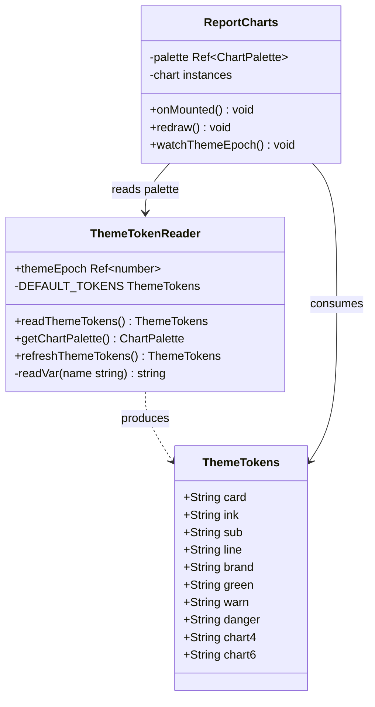
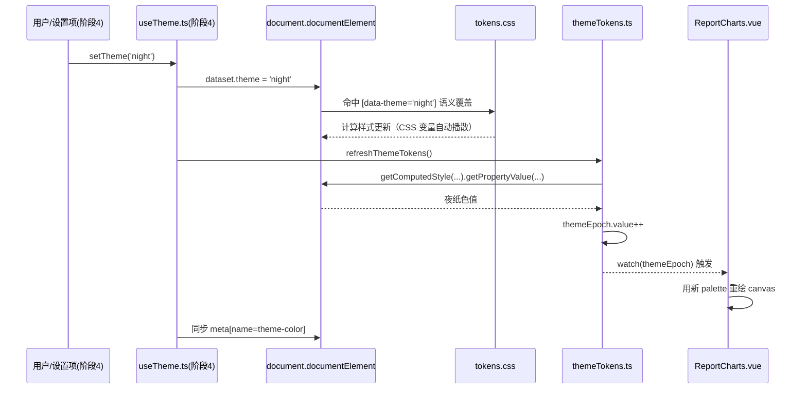
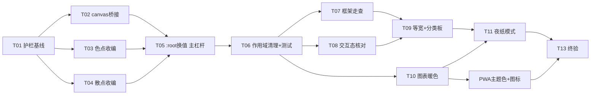

# FamBean 全站纸质暖色迁移 · 实施架构与任务分解方案（评审稿）

| 项 | 内容 |
|---|---|
| 文档 | `docs/paper-theme-migration-plan.md` |
| 作者 | Bob（软件架构师） |
| 状态 | **已评审通过（2026-11-17）**：纸质方向 + 夜纸完整可切换 + PWA 图标重绘，三项均老板拍板；可进入施工。**按老板口径 `docs/` 不入库，仅供评审** |
| 范围 | `frontend/` 全站换肤；不含后端、数据、业务逻辑 |
| 依据 | 产品已定方向 + 已完成的代码勘察事实（本文视为真实，不重复勘察） |
| 纪律 | 本阶段只做设计与规划，**未修改任何源码、未 commit** |

---

## 0. 结论摘要（给老板的一页纸）

**一句话核心杠杆**：全站换肤不是"逐组件改颜色"，而是**把 `.rs-mask, .slip` 作用域里已经验收过的整套暖纸 token 提升为 `:root` 全局值，再删掉作用域重复声明**。由于 30+ 处引用全部是 `var(--fb-*)`，值一改全站自动跟随；而小票/记一笔因为新值与原作用域值**逐字相同**，视觉天然零变化。这是整个方案风险最低、改动最小、回滚最快的主路径。

**六条架构决策**：

1. **单一 token 源**：暖纸作用域 token → `:root`；作用域块删除重复声明（不保留"同值副本"，那正是老板否决的双轨）。
2. **变量名保留**：`--fb-blue` 继续叫 `--fb-blue`，只把值从 `#3b6ef6` 换成 `#2f5d4e`；**不引入 `--fb-brand` 别名**。改名是独立技术债，不混进本次换肤。
3. **Canvas 桥接**：canvas 读不到 CSS 变量，新建 `themeTokens.ts` 用 `getComputedStyle` 读 token 作为唯一色源；模块内仅保留一份"读不到时的兜底常量"并列入白名单。
4. **深色模式预留不实现**：本次只保证所有颜色走语义 token + 设计好 `[data-theme='night']` 覆盖结构；阶段4 才填值。
5. **护栏先行**：阶段0 先上"禁止组件内 hex"校验脚本 + 违规白名单，白名单随阶段递减到 0。**注意白名单必须放在 `frontend/` 内入库**（因为 `docs/` 不入库）。
6. **对比度分层**：暖色填充色比蓝色暗，`--fb-warn` 只能做图形/大字；新增 `--fb-warn-ink` / `--fb-green-ink` / `--fb-danger-ink` 三支"正文安全墨色"，否则 WCAG AA 门禁必挂。

**节奏建议**：5 次提交（阶段0~4 各一次），老板按阶段验收；**阶段1 是唯一"改一个文件就全站变色"的高杠杆低diff提交**，建议单独评审、单独留回滚点。

**总工作量估算**：约 **10 人日**（含 PWA 图标重绘集成 0.5 人日；若图标设计外包则前端侧约 9.5 人日）。

---

## 1. 总体架构决策

### 1.1 决策一：单一 token 源 = 提升暖纸作用域为 `:root`（主杠杆）

**现状**：`frontend/src/styles/tokens.css` 有两组值。
- `:root`（第 6–75 行）：科技蓝全局值，被全站 30+ 处引用。
- `.rs-mask, .slip`（第 85–143 行）：**已落地的暖纸体系**，语义名与 `:root` 完全同名，值不同（作用域覆盖）。

**目标结构**：

```
frontend/src/styles/tokens.css
├─ :root                     ← 唯一权威色源：暖纸值（从作用域逐字上提）
│   ├─ 基础族 / 语义族 / soft 族 / 阴影 / hero / 侧栏
│   ├─ 图表扩展族（--fb-chart-4 / --fb-chart-6）
│   └─ 正文安全墨色族（--fb-*-ink，新增）
├─ /* .rs-mask / .slip 色值已上提至 :root，此处不再覆盖 */
│   （仅保留确实只在小票内使用、且不该全局化的 token）
└─ [data-theme='night']      ← 阶段4 填值；本次仅注释桩
```

**上提机制（工程师照做）**：

1. 逐条读 `.rs-mask, .slip`（第 85–143 行）的每个声明。**勘察事实里"等"字表示还有未列出的 token，实施时必须以源码为准做完整清单**，不得只按本文列出的十几个改。
2. 对每一个与 `:root` 同名的 token：把作用域的值**逐字**写进 `:root` 覆盖旧值。
3. 对只在作用域存在的 token（`--fb-seal`、`--fb-font-ledger`、`--fb-font-mono` 等）：上提到 `:root`（全站已统一纸感，没有理由让它们继续局部化）。
4. 删除 `.rs-mask, .slip` 中已被上提的重复声明。
5. 保留的唯二例外：`--fb-paper` / `--fb-paper-ink` / `--fb-paper-sub` / `--fb-paper-line` / `--fb-paper-rule`（`:root` 第 6–75 行已有）**不动、不去重、不合并**——它们是小票体系的"原始色板层"，与语义层数值接近但故意并存；去重会破坏小票视觉。

**为什么这是主杠杆**：
- `var(--fb-blue)` 已在 AppLayout(4)、AccountDetailView(4)、HomeView(3)、LoginView(3)、CommoditiesView(2)、CategoriesView(1)、AwaitInviteView(1)、ReceiptSlip(2)、tokens.css 自身共 **20+ 处**引用，全部自动跟随。
- `fb-hero` class 被 11 个 View 使用，全部走 `--fb-hero-gradient`，**一处改值、11 页跟随**。
- 换肤主变更收敛到 **1 个文件**，审查成本极低，回滚 = revert 一个文件。

**安全不变式（必须写进验收）**：`:root` 新值 ≡ 原 `.rs-mask, .slip` 值（对同名 token 逐字相等）。由此推出两条自动保障：
- 小票/记一笔视觉不变（它们原本就拿这些值）；
- 全站其余页面统一变成同一套已验收过的暖纸色（不是新造配色）。

### 1.2 决策二：变量名保留，只换值（`--fb-blue` 不改名、不加别名）

**主张**：**保留 `--fb-blue` 变量名，只改值**；明确**否决**引入 `--fb-brand` 别名。

| 方案 | 评价 |
|---|---|
| ✅ 保留 `--fb-blue`，值改 `#2f5d4e` | 20+ 处引用零改动；diff 最小；回滚最简单；单源不被破坏 |
| ❌ 新增 `--fb-brand`，`--fb-blue: var(--fb-brand)` | 迁移期出现"两个名字一个值"，正是老板否决的双轨形态；回滚要同时处理两个名字 |
| ❌ 全量重命名为 `--fb-primary` | 20+ 处引用 + 所有测试断言一起改，与换肤零视觉收益，风险/收益比极差 |

**落地要求**：在 `tokens.css` 的 `--fb-blue` 行加注释说明历史命名：

```css
/* --fb-blue 为历史变量名，纸感主题下语义=品牌主色（纸墨绿），勿据字面理解为蓝色 */
--fb-blue: #2f5d4e;
```

**命名债处理**：另开独立技术债 ticket（换肤完成、稳定一个版本后）统一重命名为 `--fb-primary`；**本次迁移禁止夹带**。

### 1.3 决策三：作用域覆盖处理 = 删除，不保留同值副本

**主张**：上提后**删除** `.rs-mask, .slip` 中的重复声明，只留一行注释说明来源。

**理由**：
- "保留为同值"会形成两处定义，随时间必然漂移（某天有人只改一处），这正是老板否决的"两套 token 长期维护"。
- 单一源是硬指标，不是"值恰好一样"就算数，而是**物理上只有一处定义**。

**等价性保障（替代安全网）**：用测试保证小票视觉不回退——在 `ReceiptSlip.test.ts` 增加 computed-style 断言，锁定小票关键元素的最终计算色值（如 `--fb-card` = `#fdfbf4`、`--fb-ink` = `#242b26`、`--fb-blue` = `#2f5d4e`）。这样即使将来有人误改作用域，测试会红。

**例外保留规则**：若实施清单中发现确有小票专属、不应全局化的 token，可留在作用域内，但必须在本文附录A登记并给出理由；不允许"没想清楚就先留着"。

### 1.4 决策四：Canvas 色值方案 —— `themeTokens.ts` 桥接模块

**问题**：`ReportCharts.vue` 是 `<canvas>` 绘制（第 40–44、189 行），`ctx.fillStyle` / 图表配置对象里的字符串常量无法解析 `var(--fb-*)`；JS 侧读不到 CSS 变量。硬编码 hex 又违反阶段0 起的纪律。

**方案**：新建 `frontend/src/styles/themeTokens.ts`，作为 **CSS token → JS 的唯一读桥**。



**接口契约**：

- `readVar(name)`：`getComputedStyle(document.documentElement).getPropertyValue(name).trim()`。
- `readThemeTokens()`：读取 `['--fb-card','--fb-ink','--fb-sub','--fb-line','--fb-blue','--fb-green','--fb-warn','--fb-danger','--fb-chart-4','--fb-chart-6']`，返回强类型对象。
- `getChartPalette()`：把 `ThemeTokens` 映射成 `ChartPalette`（`grid=line`、`ink=sub`、`expense=brand`、`income=green`、`pie=[brand,green,warn,chart4,danger,chart6]`）。
- `refreshThemeTokens()`：重新读取并 **`themeEpoch.value++`**；`themeEpoch` 是给阶段4 深色模式预留的"重绘信号"，本次不接任何切换 UI。
- `DEFAULT_TOKENS`：**模块内唯一允许的 JS 色值字面量**，仅在 `getPropertyValue` 返回空串（jsdom/SSR/样式未加载）时兜底；列入护栏白名单。

**为什么不用"JS 常量集中"方案**：那会形成 CSS token 与 JS 常量两份色源，阶段1 换值时必须两处同步——直接违反硬指标一。读桥方案让 CSS 仍是唯一源。

**Safari 14.1 / iOS 14.8 兼容**：`getComputedStyle`、`getPropertyValue`、`String.prototype.trim` 均安全；不引入 `structuredClone` / `.at()` / `:has()` / `dvh` / `inset` / flex `gap`。绘制路径不变。

**调用时序**：`onMounted` 后读取一次 → 存入 `ref` → 渲染；不监听任意 CSS 变化（避免高频重绘）。阶段4 由主题切换显式调用 `refreshThemeTokens()` 触发 `watch(themeEpoch)` 重绘。

### 1.5 决策五：深色模式数据结构（阶段4 用，本次只预留）

**三层 token 结构**：

```
L1 原始色板层  --fb-paper-* / --fb-ink-* 等（值，不直接被组件引用）
    ↓ 引用
L2 语义层      --fb-bg / --fb-card / --fb-ink / --fb-sub / --fb-line /
               --fb-blue(品牌) / --fb-green / --fb-warn / --fb-danger /
               --fb-sidebar / --fb-side-fg / --fb-hero-gradient / ...
    ↓ 引用
L3 组件层      本次不新增；组件直接用 L2 + var(--fb-font-numeric)
```

**切换机制**：在 `<html>` 上设 `data-theme="night"`；`tokens.css` 末尾的 `[data-theme='night'] { ... }` **只覆盖 L2 的值**，组件代码零改动。



**本次（阶段1–3）只做三件预留，不做实现**：
1. 所有颜色引用必须是 `var(--fb-*)`，不得出现第二处色值定义（护栏保证）。
2. `tokens.css` 末尾加注释桩：`/* [data-theme='night'] 语义覆盖见阶段4；禁止在组件内做主题分支 */`。
3. `themeTokens.ts` 暴露 `refreshThemeTokens()` / `themeEpoch` 接口，让阶段4 有明确挂点。

**阶段4 需澄清的设计点**（见附录A）：manifest 的 `theme_color` 是静态字段，无法随运行期主题切换；方案二选一——(a) 备两份 manifest 动态换 `link[rel=manifest]` 的 href，或 (b) 接受 manifest 固定为浅纸色、仅动态更新 `<meta name="theme-color">`。**建议 (b)**，成本更低且用户可感知的浏览器 chrome 着色已生效。

### 1.6 决策六：禁止组件内写死 hex —— 护栏方案

**主方案（零新依赖，贴合现有 vitest 文本断言先例 `RecordSheet.iosFont.test.ts`）**：

- 新建 `frontend/scripts/check-theme-sources.mjs`：扫描 `frontend/src/**/*.{vue,ts,css}`，匹配 `#[0-9a-fA-F]{3,8}\b` 与 `rgba?\(`，报告文件:行号。
- 白名单 `frontend/scripts/theme-exceptions.json`（**入库**，`docs/` 不入库）：

```json
{
  "allowFiles": [
    "src/styles/tokens.css",
    "src/styles/themeTokens.ts"
  ],
  "allowLines": [
    { "file": "src/components/ReportCharts.vue", "line": 40, "reason": "T02 收编后删除" }
  ]
}
```

- `frontend/src/styles/theme.guard.test.ts`：调用脚本逻辑，任一未授权命中即测试失败，随 400 用例一起跑。
- `frontend/package.json` 增加 `"check:theme": "node scripts/check-theme-sources.mjs"`。
- **白名单随阶段递减**：阶段0 登记全部已知违规，每收编一处删一条，阶段4 清零到 `allowFiles` 仅剩两个文件。

**可选增强（P2，不阻塞）**：stylelint + `stylelint-config-standard-vue` + `color-no-hex` 规则，用 `overrides` 放行 `tokens.css`，换来编辑器即时提示。本次不引入以免增加依赖与 CI 时长。

---

## 2. Token 映射表（可直接照抄）

**来源标注**：
- **【作用域已有】** = 直接取自 `.rs-mask, .slip`（第 85–143 行），权威值，逐字上提。
- **【paper族已有】** = `:root` 中已存在，保持不动。
- **【新增·已校验】** = 本次新提议，下方给出对比度实测值，满足门禁。
- **【待源码确认】** = 勘察事实以"等"概括，实施时以源码为准。

### 2.1 品牌与语义色

| Token | 旧 `:root` 值 | 新值 | 来源 | 用途 / 实测对比度（对 `--fb-card #fdfbf4`） |
|---|---|---|---|---|
| `--fb-blue` | `#3b6ef6` | `#2f5d4e` | 【作用域已有】 | 品牌主/强调/主按钮；文字 **7.25:1** ✅；反白字 `#fdfbf4` on 墨绿 **7.25:1** ✅ |
| `--fb-green` | `#2ba471` | `#3f7d5c` | 【作用域已有】 | 收入/成功；**4.72:1** ✅（正文刚过线） |
| `--fb-warn` | `#e8590c` | `#c8811e` | 【作用域已有】 | 警示**填充/图形/大字**；**3.07:1** ⚠️ 仅满足 ≥3:1，禁作正文 |
| `--fb-danger` | `#d93025` | `#b4463c` | 【作用域已有】 | 危险/支出；**5.22:1** ✅ |
| `--fb-seal` | 无全局 | `#c1443b` | 【作用域已有·上提】 | 印章/强调；**4.88:1** ✅ |

### 2.2 表面 / 墨色 / 线条 / 软色

| Token | 旧值 | 新值 | 来源 | 说明 / 实测 |
|---|---|---|---|---|
| `--fb-bg` | `#f5f6f8` | `#f2eee5` | 【作用域已有】 | 页面底；`#242b26` on bg = **12.52:1** ✅ |
| `--fb-card` | `#ffffff` | `#fdfbf4` | 【作用域已有】 | 卡片/纸面；正文墨 on card = **14.00:1** ✅ |
| `--fb-ink` | `#1a1d1f` | `#242b26` | 【作用域已有】 | 正文墨色 |
| `--fb-sub` | `#6b7280` | `#6b6659` | 【新增·已校验】 | 次要文字；on card **5.53:1** ✅，on bg **4.94:1** ✅，on `--fb-soft` **4.60:1** ✅。**替代低对比的 `--fb-paper-sub` 作正文** |
| `--fb-line` | `#e5e7eb` | `#d8d1bf` | 【新增·已校验】 | 边框/分隔；参考 `--fb-paper-line #c9c3b2`。装饰性，不参与文字对比 |
| `--fb-soft` | `#eef1f6` | `#ece6d8` | 【新增·已校验】 | 浅纸底；`--fb-ink` on soft **11.65:1** ✅，`--fb-sub` on soft **4.60:1** ✅ |
| `--fb-white` | `#ffffff` | `#fdfbf4` | 【新增·已校验】 | 与纸面统一。**待视觉复核**：若某处确需纯白浮层，另立 `--fb-overlay-surface:#ffffff`，禁止组件内写死 |
| `--fb-paper` | `#fdfbf4` | 保持 | 【paper族已有】 | 原始色板层，**不动、不去重** |
| `--fb-paper-ink` | `#2a2a28` | 保持 | 【paper族已有】 | 同上 |
| `--fb-paper-sub` | `#8a8578` | 保持 | 【paper族已有】 | ⚠️ on card 仅 **3.55:1**，**仅限大字/装饰**，正文一律用 `--fb-sub` |
| `--fb-paper-line` | `#c9c3b2` | 保持 | 【paper族已有】 | 同上 |
| `--fb-paper-rule` | `#ded7c6` | 保持 | 【paper族已有】 | 小票虚线/分隔，保持 |

### 2.3 soft 族 / 正文安全墨色（新增）

| Token | 旧值 | 新值 | 来源 | 实测 |
|---|---|---|---|---|
| `--fb-danger-soft` | `#fdecea` | `#f6e3df` | 【新增·已校验】 | 与 danger 配套 |
| `--fb-green-soft` | `#e8f6ef` | `#e3efe4` | 【新增·已校验】 | 与 green 配套 |
| `--fb-blue-soft` | `#eef3ff` | `#e6ece3` | 【新增·已校验】 | 墨绿浅底；`--fb-blue` on it **6.25:1** ✅ |
| `--fb-warn-soft` | `#fff0e6` | `#f8ecd8` | 【新增·已校验】 | 与 warn 配套 |
| `--fb-blue-line` | `#cfdcfd` | `#c3cec1` | 【新增·已校验】 | 墨绿描边 |
| `--fb-on-hero-muted` | 蓝色期值 | `#c9d6cc` | 【新增·已校验】 | on hero 起点 `#1f332c` = **8.91:1** ✅ |
| `--fb-on-hero-pill` | 蓝色期值 | `#f2eee5` | 【新增·已校验】 | on `--fb-blue` = **6.49:1** ✅（**以作用域源码现成值为准**） |
| `--fb-warn-ink` | 无 | `#8f5210` | 【新增·已校验】 | **正文安全警示墨**；on `--fb-warn-soft` **5.32:1** ✅ |
| `--fb-green-ink` | 无 | `#366b4d` | 【新增·已校验】 | **正文安全成功墨**；on `--fb-green-soft` **5.27:1** ✅ |
| `--fb-danger-ink` | 无 | `#a33c33` | 【新增·已校验】 | **正文安全危险墨**；on `--fb-danger-soft` **5.22:1** ✅ |

> **为什么必须新增 `*-ink`**：直接用 `--fb-warn #c8811e` 作正文，对 card 只有 3.07:1、对 warn-soft 只有 2.72:1，会直接把 WCAG AA 正文门禁打挂。填充色与正文墨色分离是本次必须做的结构调整，不是过度设计。

### 2.4 侧栏 / hero / 阴影

| Token | 旧值 | 新值 | 来源 | 实测 |
|---|---|---|---|---|
| `--fb-sidebar` | `#15203b` | `#20352c` | 【新增·已校验】 | 深墨绿；参考 hero 起点 `#1f332c`。与旧侧栏同层级明度 |
| `--fb-side-fg` | `#c7d0e0` | `#d8d2c3` | 【新增·已校验】 | on sidebar **8.67:1** ✅ |
| `--fb-side-head` | `#7e8aa3` | `#9a9c8c` | 【新增·已校验】 | on sidebar **4.67:1** ✅（更深的 `#929585` 只有 4.27:1，不可用） |
| `--fb-hero-gradient` | `linear-gradient(150deg,#1d2b5f 0%,#2e4bb8 55%,#3b6ef6 100%)` | `linear-gradient(150deg,#1f332c,#2f5d4e,#3f735e)` | 【作用域已有】 | 11 个 `fb-hero` View 自动跟随 |
| `--fb-shadow-card` | `0 2px 12px rgba(23,32,68,.05)` | `0 2px 12px rgba(60,48,28,.06)` | 【待源码确认】 | **优先逐字取作用域现成暖褐阴影值**；此值为兜底提议 |
| `--fb-shadow-header` | `0 8px 24px rgba(21,32,59,.18)` | `0 8px 24px rgba(40,35,25,.18)` | 【待源码确认】 | 同上 |

### 2.5 图表扩展 token（阶段0 用旧值建立，阶段3 换成暖值）

> 图表色 1/2/3/5 直接复用 `--fb-blue / --fb-green / --fb-warn / --fb-danger`，**不为它们建别名**（避免双源）。只有两个原色板里没有语义对应的分类色需要新 token：

| Token | 阶段0 值（零视觉变化） | 阶段3 值 | 原硬编码位置 | 对 card 对比度 |
|---|---|---|---|---|
| `--fb-chart-4` | `#8b5cf6` | `#8a6d4f`（暖褐） | `ReportCharts.vue` `PIE_COLORS[3]` | 旧 4.09:1 → 新 **4.63:1** ✅ |
| `--fb-chart-6` | `#0ea5e9` | `#5c8a86`（雾青） | `ReportCharts.vue` `PIE_COLORS[5]` | 旧 2.68:1 ❌ → 新 **3.73:1** ✅（图形 ≥3:1） |

**阶段0 新增时值与旧值完全相同**，故视觉零变化；阶段3 改值后自动生效。

### 2.6 不变量（禁止改动）

| 项 | 说明 |
|---|---|
| `--fb-font-numeric: tabular-nums` | 硬指标二，保持 |
| 圆角 / 间距 token | 本次只换色，不动布局节奏 |
| `--vvh`、记一笔键盘机制 | 兼容硬约束，不碰 |
| `--fb-paper-*` 五兄弟 | 小票原始色板，不合并、不去重 |
| Safari 14.1 禁用语法 | 不引入 `:has()` / `dvh` / `inset` / flex `gap` / `.at()` / `structuredClone` |

---

## 3. 分阶段任务分解（施工单）

**通用任务卡字段**：目标 / 源文件 / 改动 / 依赖 / 验收 / 回滚。
**阶段退出门禁**：统一执行第 5 节的 G1–G4 四门禁 + 视觉对比；任一不绿不得进入下一阶段。

---

### 阶段0「固化」：抽散落硬编码为 token，视觉零变化

> 本阶段**不改任何色彩值**，只建立护栏与 token 化。退出时 400 用例全绿、截图零差异。

#### T01 建立主题护栏与基线

| 字段 | 内容 |
|---|---|
| **目标** | 在动任何颜色前，先让"组件内写死颜色"变成可检测的红灯 |
| **源文件** | `frontend/scripts/check-theme-sources.mjs`（新）<br>`frontend/scripts/theme-exceptions.json`（新）<br>`frontend/src/styles/theme.guard.test.ts`（新）<br>`frontend/package.json`（加 `check:theme` script） |
| **改动** | 1) 脚本扫描 `src/**/*.{vue,ts,css}` 的 hex / `rgb()` 字面量，输出 `文件:行号`；2) 白名单登记勘察事实中的全部已知违规（ReportCharts 6 处常量 + ctx.fillStyle、ReportsView 6 处、ImportView 1、RestoreView 1、ReceiptSlip.test.ts 1）；3) `pull-full.json` 的 hex **先不登记为违规**（见 T04 裁定）；4) vitest 包一层断言 |
| **依赖** | 无（**起手任务**） |
| **验收** | `npm run check:theme` 能跑且报告被白名单覆盖；`npm run test` 400/400 绿；`tokens.css` 未改动；`git diff --stat` 只含 4 个新/改文件 |
| **回滚** | 删除 3 个新文件 + 撤销 `package.json` 一行 script |

#### T02 Canvas 主题色桥接收编 ReportCharts

| 字段 | 内容 |
|---|---|
| **目标** | 让 canvas 绘制也从 CSS token 取色，消灭 8 处 JS 色值硬编码 |
| **源文件** | `frontend/src/styles/themeTokens.ts`（新）<br>`frontend/src/components/ReportCharts.vue`（第 40–44、189 行）<br>`frontend/src/styles/tokens.css`（仅追加 `--fb-chart-4:#8b5cf6; --fb-chart-6:#0ea5e9;` 两行） |
| **改动** | 1) 按 §1.4 实现 `readThemeTokens` / `getChartPalette` / `refreshThemeTokens` / `themeEpoch` / `DEFAULT_TOKENS`；2) `GRID` 改读 `palette.grid`（=`--fb-line`）、`INK` 改 `palette.ink`（=`--fb-sub`）、`EXPENSE` 改 `palette.expense`、`INCOME` 改 `palette.income`、`PIE_COLORS` 改 6 项映射、`ctx.fillStyle='#1a1d1f'` 改 `palette.ink`；3) `onMounted` 读取 + `ref` 渲染；4) 新增 `themeTokens.test.ts` 验证兜底与映射 |
| **依赖** | T01（白名单可先容忍旧值，收编后逐条删除） |
| **验收** | 图表截图与改造前**逐像素一致**；`check:theme` 违规数下降；新增单测绿；400/400 绿 |
| **回滚** | revert 上述 3 文件；`--fb-chart-*` 两行一并删除 |

#### T03 ReportsView 色点收编

| 字段 | 内容 |
|---|---|
| **目标** | 6 个硬编码色点改用 CSS 变量 |
| **源文件** | `frontend/src/views/ReportsView.vue`（第 337–341 行 `rpt__dot--income/expense/0~5`） |
| **改动** | 6 处 hex → `var(--fb-green)` / `var(--fb-blue)` / `var(--fb-warn)` / `var(--fb-chart-4)` / `var(--fb-danger)` / `var(--fb-chart-6)`；不新增 class 结构 |
| **依赖** | T01（与 T02 可**并行**，因改动文件不重叠；但 token 值依赖 T02 在 tokens.css 追加的两行，故合并验收前需 T02 落地） |
| **验收** | 报表页截图零差异；`check:theme` 中 6 条违规从白名单移除 |
| **回滚** | revert 单文件 |

#### T04 零散 hex 收编与 fixture 裁定

| 字段 | 内容 |
|---|---|
| **目标** | 清掉剩余散点，并对 fixture 做出有理由的裁定 |
| **源文件** | `frontend/src/views/ImportView.vue`（1 处）<br>`frontend/src/views/RestoreView.vue`（1 处）<br>`frontend/src/components/ReceiptSlip.test.ts`（1 处断言色）<br>`frontend/scripts/theme-exceptions.json`（白名单收缩） |
| **改动** | 1) 两处 View hex → `var(--fb-*)`；2) 测试断言色改为引用 token 常量/读 computed style，不再写死；3) **`core/sync/fixtures/pull-full.json` 不动**——裁定理由：它是后端同步的**业务数据样本**，hex 属于数据字段而非主题定义，改它等于篡改测试夹具；若后续确认该字段会渲染到 UI，则只在消费端做 token 映射，不改 fixture 本身 |
| **依赖** | T01（与 T02/T03 **并行**） |
| **验收** | 白名单仅剩 `allowFiles` 两项 + 明确标注的确认项；400/400 绿；三处页面视觉零差异 |
| **回滚** | revert 4 文件（白名单回退） |

**阶段0 退出检查**：截图对比零差异 · G1/G2 绿 · 违规清单归零 · 阶段1 的 token 变更面已收敛为 `tokens.css` 单文件。

---

### 阶段1「基底」：换背景/表面/边框/墨色/语义色/阴影 token

> 本阶段是**核心杠杆**：主变更只有 1 个文件。必须单独提交、单独评审、单独留回滚点。

#### T05 `:root` 全局 token 换值（主杠杆）

| 字段 | 内容 |
|---|---|
| **目标** | 按 §2 映射表，把暖纸值写入 `:root`（第 6–75 行），全站基底变暖 |
| **源文件** | `frontend/src/styles/tokens.css`（**仅此 1 文件**） |
| **改动** | 1) 先完整抄录 `.rs-mask, .slip`（第 85–143 行）全部声明，逐条上提到 `:root`（同名覆盖，专属名新增）；2) 按 §2.2–2.4 补入 `--fb-sub/line/soft/white`、`--fb-sidebar/side-fg/side-head`、`--fb-warn-ink/green-ink/danger-ink`、`--fb-on-hero-*`；3) **不动** `--fb-chart-4/6`（保持旧值，留给阶段3）、不动 `--fb-paper-*`、不动字体/圆角/间距/`--vvh`；4) `--fb-blue` 加历史命名注释（§1.2）；5) 末尾加 `[data-theme='night']` 注释桩（§1.5） |
| **依赖** | T01、T02、T03、T04 全部完成（确保无残留硬编码绕过 token） |
| **验收** | ① 全站背景/卡片/墨色/侧栏/hero 呈纸墨暖色；② `.rs-mask/.slip` 视觉与改造前**逐像素一致**（因值逐字相同）；③ `check:theme` 零违规；④ `tokens.contrast.test.ts` 全过（T06 提供）；⑤ 无 Safari 14.1 禁用语法；⑥ 400/400 绿 |
| **回滚** | `git revert` 该单文件提交即可全站瞬时回退到科技蓝——这是本方案最大的风险对冲 |

#### T06 作用域覆盖清理与纸感等价性保障

| 字段 | 内容 |
|---|---|
| **目标** | 物理删除重复定义，并用测试锁死小票视觉 |
| **源文件** | `frontend/src/styles/tokens.css`（删除第 85–143 行中已上提的声明，仅留注释）<br>`frontend/src/components/ReceiptSlip.test.ts`（增加 computed-style 断言）<br>`frontend/src/styles/tokens.contrast.test.ts`（新，WCAG 校验） |
| **改动** | 1) 按 §1.3 删除作用域重复声明（**以 T05 的完整清单为准，逐条确认无遗漏**）；2) 小票关键元素色值 golden 断言；3) 对比度测试：解析 `tokens.css` `:root` 块，按 §2 的配对表计算并断言（正文 ≥4.5、大字/UI ≥3.0） |
| **依赖** | T05（**强串行**，必须先上提再删作用域，否则小票瞬间失色） |
| **验收** | 小票/记一笔截图逐像素一致；作用域中只剩附录A登记的例外；对比度测试全绿；400+/400 绿 |
| **回滚** | 从 T05 快照恢复作用域块；或整阶段 revert（T05+T06 同 PR 内两个 commit，便于分段回滚） |

**阶段1 退出检查**：G1–G4 全绿 + 小票零差异 + **全站仅一份色值定义**。

---

### 阶段2「框架」：侧栏深蓝→深墨绿，hero 蓝渐变→纸墨，导航/标签/按钮

> 因阶段1 已换 token 值，本阶段多数页面**无需改代码**，以逐页走查 + 少量微调为主。

#### T07 侧栏 / hero / 导航框架复核

| 字段 | 内容 |
|---|---|
| **目标** | 确认框架层全部走 token，无遗漏硬编码；微调侧栏层级对比 |
| **源文件** | `frontend/src/styles/tokens.css`（侧栏 token 微调，如门禁需要）<br>`frontend/src/components/AppLayout.vue`（走查，预期零改动）<br>11 个含 `fb-hero` 的 View（走查，**预期全部零改动**） |
| **改动** | 逐页确认 `fb-hero` 生效且 `--fb-hero-gradient` 为纸墨；侧栏 `#20352c` / side-fg `#d8d2c3` / side-head `#9a9c8c` 满足对比度；焦点态/hover 态无蓝色残留 |
| **依赖** | T06 |
| **验收** | 11 页 hero 截图归档；侧栏正文 ≥4.5:1、UI ≥3:1；无 `#3b6ef6` / `#15203b` 残留（全文搜索） |
| **回滚** | revert token 微调；走查无改动则不产生回滚成本 |

#### T08 导航 / 标签 / 按钮语义色核对

| 字段 | 内容 |
|---|---|
| **目标** | 消除交互态的科技蓝残留 |
| **源文件** | `frontend/src/views/CategoriesView.vue`、`CommoditiesView.vue`、`LoginView.vue`、`AwaitInviteView.vue`、`frontend/src/components/AppLayout.vue` |
| **改动** | 确认 active 标签、链接、按钮 primary、邀请码按钮等全部 `var(--fb-blue)` / `var(--fb-*)`；focus ring 用 token；不新增组件内色值 |
| **依赖** | T06（与 T07 **并行**） |
| **验收** | 四页交互态截图；禁用色扫描通过；400/400 绿 |
| **回滚** | revert 单页文件（预期多为零改动） |

**阶段2 退出检查**：11 个 hero 页 + 4 个交互密集页走查记录归档，无蓝色残留。

---

### 阶段3「数据密集页」：账目列表/报表/图表等宽数字、暖色分类板、对比度

#### T09 等宽数字与暖色分类板

| 字段 | 内容 |
|---|---|
| **目标** | 落实硬指标二：金额 `tabular-nums` 对齐；分类板换暖色 |
| **源文件** | `frontend/src/views/AccountsView.vue`、`AccountDetailView.vue`、`ReportsView.vue`、`LedgersView.vue`、`CategoriesView.vue`、`frontend/src/styles/tokens.css` |
| **改动** | 1) 所有金额/数字列统一应用 `font-variant-numeric: tabular-nums`（通过 `var(--fb-font-numeric)` 或工具类），确保小数点与位数纵向对齐；2) 分类 chip/图例改用暖色语义 token（收入 `--fb-green`、支出 `--fb-blue`/`--fb-danger`、分类 0–5 用 `--fb-blue/green/warn/chart-4/danger/chart-6`）；3) 分类文字若落在 soft 底上，改用 `--fb-*-ink` 而非填充色；4) 增加"金额列等宽"断言测试（源码文本断言或 DOM 计算样式断言，参照 `RecordSheet.iosFont.test.ts` 先例） |
| **依赖** | T07、T08 |
| **验收** | 账目/报表/明细页截图中小数点列对齐；分类板全暖色；新增等宽断言绿；400+/400 绿 |
| **回滚** | revert 本任务文件（token 已由阶段1 提供，回滚不影响基底） |

#### T10 图表调色板暖色化与 canvas 复核

| 字段 | 内容 |
|---|---|
| **目标** | 阶段0 建立的两个临时旧值 token 换成暖值，图表整体入纸感 |
| **源文件** | `frontend/src/styles/tokens.css`（`--fb-chart-4:#8a6d4f`、`--fb-chart-6:#5c8a86`）<br>`frontend/src/styles/themeTokens.ts`（复核映射，无需结构改动）<br>`frontend/src/components/ReportCharts.vue`（复核重绘）<br>`frontend/src/views/ReportsView.vue`（图例色点已在 T03 token 化，复核一致性） |
| **改动** | 两处 token 换值；核对 6 色在纸底上可区分且 ≥3:1（图形门槛）；核对 canvas 与 DOM 图例颜色一致 |
| **依赖** | T06（与 T09 **并行**，文件不重叠） |
| **验收** | 报表截图 6 色暖且可辨；`--fb-chart-6` 从 2.68:1 提升到 3.73:1；canvas/图例色一致；400+/400 绿 |
| **回滚** | revert 两个 token 行即回到阶段0 图表配色 |

**阶段3 退出检查**：G3 对比度全过（含图表图形色）、G4 兼容扫描通过、等宽断言绿。

---

### 阶段4「收尾」：夜纸深色模式、PWA theme-color / manifest / 图标

#### T11 夜纸深色模式数据结构落地

| 字段 | 内容 |
|---|---|
| **目标** | 按 §1.5 结构填值，提供可切换的夜纸主题 |
| **源文件** | `frontend/src/styles/tokens.css`（`[data-theme='night']` 语义覆盖块）<br>`frontend/src/styles/themeTokens.ts`（接 `refreshThemeTokens`）<br>`frontend/src/composables/useTheme.ts`（新）<br>设置入口 View（**文件名待确认**，见附录A） |
| **改动** | 1) 在 `[data-theme='night']` 只覆盖 L2 语义 token（夜纸底/墨/浅墨/边框/侧栏/hero/阴影），组件零改动；2) `useTheme` 设 `document.documentElement.dataset.theme` 并同步 `<meta name="theme-color">`；3) 调用 `refreshThemeTokens()` 触发图表重绘；4) 夜纸配对全部过 WCAG AA |
| **依赖** | T09、T10 |
| **验收** | 浅/夜切换全站无蓝色残留、图表正确重绘、夜纸正文 ≥4.5:1；iOS 14.8 冒烟通过 |
| **回滚** | revert 本任务文件；浅色路径不受影响（默认无 `data-theme`） |

#### T12 PWA 主题色与图标

| 字段 | 内容 |
|---|---|
| **目标** | 安装态/浏览器 chrome 与纸墨一致 |
| **源文件** | `frontend/index.html`（第 12 行 meta）<br>`frontend/public/manifest.json`（第 6 行 `background_color`、第 7 行 `theme_color`）<br>`frontend/public/icons/Icon-192.png`、`Icon-512.png`、`maskable×2`、`favicon.png` |
| **改动** | 1) meta `theme-color` 与 manifest `theme_color` → `#20352c`（深墨绿，与侧栏/hero 呼应）；2) manifest `background_color` → `#f2eee5`（纸底）；3) **图标重绘建议**：现有 4 个蓝色豆子图标 + favicon 与新色系冲突，**建议重绘**为 `#2f5d4e` 豆子 + `#fdfbf4` 纸底，由单一 SVG 母版导出 192/512/maskable/favicon，maskable 需预留安全区（主体在中心 80% 内）；4) 若排期紧，可先完成 1–2 项（功能门禁不阻塞），图标作为独立小 PR 收尾 |
| **依赖** | T06 起即可并行；**建议排在 T10 之后**集中提交 |
| **验收** | 真机安装 PWA，浏览器 chrome 着色为墨绿；启动屏纸底；5 个图标无蓝色残留 |
| **回滚** | revert 文本两文件 + 恢复旧图标二进制（建议重绘前备份原图到 `tmp/`） |

#### T13 终验与护栏清零

| 字段 | 内容 |
|---|---|
| **目标** | 白名单清零、四门禁终验、交付验收包 |
| **源文件** | `frontend/scripts/theme-exceptions.json`（`allowLines` 清空）<br>`docs/paper-theme-migration-plan.md`（评审稿回填结论，不入库） |
| **改动** | 全量跑 G1–G4 + 400+ 用例 + 截图归档；输出"13 处硬编码 → 0"清单 |
| **依赖** | T11、T12 |
| **验收** | 白名单只剩两个 `allowFiles`；四门禁全绿；老板按阶段签收 |
| **回滚** | 不适用（终验态） |

---

### 3.X 任务依赖图



**并行 / 串行判定**：

| 关系 | 任务 | 判定 | 理由 |
|---|---|---|---|
| 并行 | T02 / T03 / T04 | ✅ 并行 | 文件不重叠；T03 依赖 T02 在 tokens.css 追加两行，合入前同步即可 |
| 串行 | T05 → T06 | ❌ 强串行 | 必须先上提再删作用域，顺序颠倒会导致小票失色 |
| 并行 | T07 / T08 | ✅ 并行 | 走查范围不同 |
| 并行 | T09 / T10 | ✅ 并行 | T09 改 View，T10 改 token + canvas 模块，文件不重叠 |
| 并行 | T11 / T12 | ✅ 并行 | 深色模式与 PWA 资源互不依赖 |
| 串行 | 各阶段之间 | ❌ 逐阶段串行 | 每阶段必须过四门禁才进入下一阶段 |

---

## 4. 风险清单与规避

| # | 风险 | 等级 | 表现 | 规避措施 |
|---|---|---|---|---|
| R1 | **canvas 色值绕过 token** | 高 | 图表在阶段1 全站变暖后仍显蓝、绿 | T02 前置建立 `themeTokens.ts` 读桥；阶段1 门禁全文搜索 `#3b6ef6`/`#2ba471` 归零；阶段3 复核 canvas/DOM 图例一致 |
| R2 | **PWA 蓝色图标与暖色冲突** | 中 | 桌面图标、启动屏仍是蓝豆子，观感拼凑 | T12 重绘 5 个资源；排期紧时先改 theme-color/background_color（不阻塞功能门禁），图标独立收尾 |
| R3 | **暖语义色对比度不足** | 高 | `--fb-warn` 3.07:1、`--fb-chart-6` 旧值 2.68:1 不达 AA | 拆分填充色与正文墨色（`--fb-*-ink`）；图表色换 `#5c8a86`；`tokens.contrast.test.ts` 硬断言，门禁 G3 卡死 |
| R4 | **`--fb-paper-sub` 被误用为正文** | 中 | 现有值仅 3.55:1，正文不达标 | 映射表明确"仅大字/装饰"；新增 `--fb-sub #6b6659` 作正文；门禁检查正文选择器不得引用 paper-sub |
| R5 | **双轨残留**（作用域同值副本未删） | 高 | 老板否决的形态；日后漂移 | T06 物理删除重复声明；测试锁定小票计算样式；终验白名单只剩两个 allowFiles |
| R6 | **iOS 14 / Safari 14.1 兼容** | 高 | 换肤时顺手引入 `:has()`/`dvh`/`inset`/flex `gap`/`.at()`/`structuredClone` 导致白屏 | 阶段1/3 门禁 G4 扫描禁用语法；`--vvh`、记一笔键盘机制列为不变量；按 `docs/ios14-smoke-checklist.md` 做真机冒烟 |
| R7 | **测试假绿** | 中 | 400 用例不校验颜色，换肤后仍全绿但视觉不对 | 新增三类正向断言：token 值断言、对比度断言、等宽断言 + 截图基线与白名单守卫；每阶段截图归档 |
| R8 | **fixture 中的 hex 被"顺手改掉"** | 低 | 篡改测试数据导致同步用例失败 | T04 明确裁定不改 `pull-full.json`；若消费端渲染该字段，只在消费端映射 |
| R9 | **作用域 token 清单不完整**（勘察事实"等"） | 高 | 漏上提某个 token，导致小票或某页失色 | T05 必须以源码第 85–143 行完整抄录为准，不依赖本文举例；T06 逐条核销；小票 golden 断言兜底 |
| R10 | **`--fb-white` 语义歧义** | 低 | 换成纸色后某纯白浮层变米色 | 映射表标注"待视觉复核"；确需纯白时另立 `--fb-overlay-surface`，禁止组件内写死 |
| R11 | **深色模式提前实现导致范围蔓延** | 中 | 阶段1 就写 `[data-theme]` 值，产生第二套色值 | 本次只加注释桩与接口；值一律留到阶段4；评审时检查阶段1–3 diff 中无夜纸色值 |
| R12 | **docs 不入库导致白名单丢失** | 低 | 护栏白名单写到 `docs/` 后 CI 读不到 | 白名单强制放 `frontend/scripts/theme-exceptions.json`；`docs/` 仅放评审文档 |

---

## 5. 验收与回归方案

### 5.1 四门禁定义（每阶段必过）

| 门禁 | 名称 | 判定标准 | 执行方式 |
|---|---|---|---|
| **G1** | 单源门禁 | `check:theme` 零未授权 hex；色值只在 `tokens.css` + `themeTokens.ts` 出现；白名单递减无反弹 | `npm run check:theme` + `npm run test`（含 `theme.guard.test.ts`） |
| **G2** | 测试门禁 | 52 文件 / 400 用例全绿（新增断言后为 400+）；`tsc --noEmit`；`vite build` 通过 | 现有 CI + 新增用例 |
| **G3** | 对比度门禁 | 正文 ≥4.5:1；大字/UI/图形 ≥3:1；按 §2 配对表逐条断言 | `tokens.contrast.test.ts` |
| **G4** | 兼容门禁 | 无 Safari 14.1 禁用语法；iOS 14.8 冒烟通过；`--vvh` / 键盘机制未变 | `check-theme-sources.mjs` 附加规则 + `docs/ios14-smoke-checklist.md` |

**附加视觉门禁（V）**：每阶段在相同路由、相同视口截图，与基线对比；阶段0 与阶段1 的小票页必须**逐像素一致**。

### 5.2 每阶段验证矩阵

| 阶段 | G1 | G2 | G3 | G4 | 视觉门禁 V | 重点 |
|---|---|---|---|---|---|---|
| 0 固化 | ✅ | ✅ | 基线记录 | ✅ | **零差异** | 所有页面截图与改造前逐像素一致 |
| 1 基底 | ✅ | ✅ | ✅ | ✅ | 小票**零差异**；其余全站变暖 | 单文件 diff 审查 + 小票 golden |
| 2 框架 | ✅ | ✅ | ✅ | ✅ | 11 hero 页 + 4 交互页归档 | 无蓝色残留全文搜索 |
| 3 数据 | ✅ | ✅ | ✅ | ✅ | 小数点列对齐截图 | 等宽断言 + 图表 6 色可辨 |
| 4 收尾 | ✅ | ✅ | **夜纸双主题均过** | ✅ | 浅/夜双套归档 | PWA 真机安装验证 |

### 5.3 token 断言脚本做法（可执行）

`frontend/src/styles/tokens.contrast.test.ts`：

1. `readFileSync('src/styles/tokens.css','utf8')`，正则截取 `:root\s*\{([^}]*)\}` 得到声明块。
2. 解析成 `Map<tokenName, value>`（hex 与 `linear-gradient` 分别处理，渐变只校验关键色标）。
3. 正向断言：`expect(map.get('--fb-blue')).toBe('#2f5d4e')` 等（把 §2 映射表变成可执行测试，防止值被悄悄改回去）。
4. 对比度：实现 WCAG 相对亮度公式（sRGB → 线性 → 0.2126R+0.7152G+0.0722B），按 §2 的配对表计算 `ratio`，断言正文 ≥4.5、图形 ≥3.0。
5. 结构断言：`.rs-mask, .slip` 块中不得存在与 `:root` 同名的声明（R5 双轨检测）。

### 5.4 截图/视觉回归做法

- 基线目录用仓库内已存在的 `.screenshots/`（或新建 `frontend/tests/screenshots/`，**不要放 `docs/`**，因其不入库）。
- 固定路由清单：记一笔、账目列表、账目详情、报表、分类、商品、登录、邀请、数据安全的 hero 页。
- 阶段0/1 用**逐像素比对**（小票页）；阶段2–4 用人工归档 + 关键页比对。
- 若后续引入 Playwright/Chromatic 做自动视觉回归，作为 P2 增强，本次不阻塞。

### 5.5 400 用例保护

- 每个阶段 PR 必须跑全量；任何用例变红不得合并。
- 新增用例（themeTokens、contrast、guard、等宽、小票 golden）计入总数，交付时报告新总数。
- 测试断言色值改为读 token（T04），避免"测试写死颜色导致换肤后假绿/假红"。

---

## 6. 工作量与交付节奏建议

| 阶段 | 任务 | 预估 | 建议提交粒度 | 老板验收点 |
|---|---|---|---|---|
| 0 固化 | T01 | 0.5 人日 | **1 个 PR**（含 T01–T04，可内分 4 commit） | 视觉零变化 + 护栏就位 |
| | T02 | 1.0 人日 | | |
| | T03 | 0.5 人日 | | |
| | T04 | 0.5 人日 | | |
| 1 基底 | T05 | 0.5 人日 | **1 个 PR**（T05 单文件 commit + T06 commit，便于分段回滚） | **重点验收**：全站变暖 + 小票零差异 |
| | T06 | 1.0 人日 | | |
| 2 框架 | T07 | 0.5 人日 | **1 个 PR**（T07+T08） | 11 hero 页 + 交互态走查记录 |
| | T08 | 0.5 人日 | | |
| 3 数据 | T09 | 1.0 人日 | **1 个 PR**（T09+T10） | 等宽对齐 + 图表暖色 + 对比度 |
| | T10 | 1.0 人日 | | |
| 4 收尾 | T11 | 1.5 人日 | **1 个 PR**（T11+T12+T13） | 夜纸切换 + PWA 真机 |
| | T12 | 1.0 人日（含图标集成 0.5） | | |
| | T13 | 0.5 人日 | | |
| **合计** | | **≈10 人日** | **5 次提交** | 逐阶段签收 |

**节奏理由**：
- **阶段0 单独一次**：它是"安全网"，必须先落地再动颜色；且视觉零变化，验收成本最低。
- **阶段1 单独一次且最小 diff**：只有 `tokens.css` 一个主文件，一旦观感不理想，`git revert` 一个 commit 全站瞬时回退——这是整个迁移最重要的风险对冲，**不要和其他阶段混提交**。
- **阶段2/3 各一次**：走查与数据密集页改动性质不同，分开便于定位问题。
- **阶段4 一次**：图标与深色模式可并行推进，最后统一终验。

**验收粒度建议**：老板按"阶段"验收即可，不必按任务；但**阶段1 必须单独看一次**（唯一全站瞬时变化的节点）。

---

## 7. 明确的「第一步」（起手式）

老板问"怎么做"——第一步不是改颜色，是**把安全网和 canvas 读桥先立起来**。具体动这些文件：

### 阶段0 起手清单（T01 + T02 的最小可运行切片）

| 顺序 | 文件 | 动作 | 产出 |
|---|---|---|---|
| 1 | `frontend/scripts/check-theme-sources.mjs` | **新建**：扫描 `src/**/*.{vue,ts,css}` 的 hex / `rgb()`，输出 `文件:行号` | 可执行校验脚本 |
| 2 | `frontend/scripts/theme-exceptions.json` | **新建**：登记勘察事实中 13 处已知违规（`pull-full.json` 暂不登记） | 迁移期违规台账（入库） |
| 3 | `frontend/src/styles/theme.guard.test.ts` | **新建**：包一层脚本断言 | 违规即测试红 |
| 4 | `frontend/package.json` | 加 `"check:theme": "node scripts/check-theme-sources.mjs"` | 一条命令可跑 |
| 5 | `frontend/src/styles/tokens.css` | **仅追加两行**（值 = 旧值，视觉零变化）：`--fb-chart-4:#8b5cf6;` `--fb-chart-6:#0ea5e9;` | 图表扩展 token 就位 |
| 6 | `frontend/src/styles/themeTokens.ts` | **新建**：`readThemeTokens` / `getChartPalette` / `refreshThemeTokens` / `themeEpoch` / `DEFAULT_TOKENS` | CSS→JS 唯一读桥 |
| 7 | `frontend/src/components/ReportCharts.vue` | 第 40–44、189 行 8 处硬编码 → `palette.*` | canvas 入 token 体系 |
| 8 | `frontend/src/styles/themeTokens.test.ts` | **新建**：映射与兜底单测 | 读桥可测 |

### 起手式验收命令

```bash
cd D:/Project/Self/FamBean/frontend
npm run check:theme     # 违规全部被白名单覆盖，退出码 0
npm run test            # 400/400 绿（新增用例后 400+）
npm run build           # 构建通过
```

### 起手式产出物（给老板看的三样东西）

1. **一条命令就能拦住"组件内写死 hex"** 的护栏（`npm run check:theme`）。
2. **一份 13 处散落色值的台账**（`theme-exceptions.json`），每收编一处删一条，进度可量化。
3. **图表已经从 CSS token 取色**，且截图与改造前逐像素一致——证明"零视觉变化的 token 化"这条路走得通。

完成这三样，才动 `tokens.css` 的配色值（阶段1 T05）。**先立规、再换色**——这是本案的起手纪律。

---

## 附录A 待澄清（Anything UNCLEAR）

| # | 待澄清项 | 影响任务 | 当前假设（未获确认前按此执行） |
|---|---|---|---|
| A1 | `.rs-mask, .slip` 第 85–143 行的**完整 token 清单**（勘察事实以"等"概括） | T05、T06 | 假设存在更多未列举 token；实施时以源码为准完整抄录，不按本文举例截断 |
| A2 | 暖褐阴影在作用域中的**现成精确值** | T05 | 假设作用域已有；若无，采用本文 §2.4 兜底值 |
| A3 | `--fb-on-hero-pill` 在作用域中的现成值 | T05 | 假设 `#f2eee5`；以源码为准 |
| A4 | 设置入口的**实际 View 文件名**（深色模式开关挂点） | T11 | 假设存在设置页；若无，挂到 DataSafetyView 或新增最小入口——需产品确认 UI 是否随本版发布 |
| A5 | manifest 是否支持"双 manifest 切换" | T11、T12 | 假设不支持/不值得；采用"manifest 固定浅纸 + 动态 meta theme-color"方案（§1.5） |
| A6 | 夜纸深色模式是否在本次版本**对外发布**，还是仅落数据结构 | T11 | **✅ 老板已拍板（2026-11-17）：一步到位，本次落地完整可切换夜纸模式**。T11 按完整切换执行（含设置入口 UI、`useTheme.ts` 持久化、canvas 重绘），不缩减为注释桩 |
| A7 | `--fb-white` 是否有"必须纯白"的浮层场景 | T05 | 假设统一为纸色；若有，另立 `--fb-overlay-surface` |
| A8 | PWA 图标是否有可复用的 SVG 母版/设计规范 | T12 | **✅ 老板已拍板（2026-11-17）：直接重绘**。按 `#2f5d4e` 豆子 + `#fdfbf4` 纸底新绘全套 5 个资源（Icon-192/512、maskable×2、favicon），从单一 SVG 母版导出 |

### A4 跟进结论（深色模式开关挂点）
夜纸模式既已确认完整实现，A4 的设置入口必须落地。实施时先定位现有设置页（预期 `SettingsView.vue` 或 `DataSafetyView.vue`），在其中新增「外观 / 主题」小节承载浅纸·夜纸切换；若现有页无合适位置，新增最小入口由产品确认。此项随 T11 一并施工，不再阻塞。

---

## 附录B 文件清单速查（按阶段）

**阶段0**
- `frontend/scripts/check-theme-sources.mjs`（新）
- `frontend/scripts/theme-exceptions.json`（新）
- `frontend/src/styles/theme.guard.test.ts`（新）
- `frontend/src/styles/themeTokens.ts`（新）
- `frontend/src/styles/themeTokens.test.ts`（新）
- `frontend/src/styles/tokens.css`（追加两行 chart token）
- `frontend/src/components/ReportCharts.vue`（第 40–44、189 行）
- `frontend/src/views/ReportsView.vue`（第 337–341 行）
- `frontend/src/views/ImportView.vue`（1 处 hex）
- `frontend/src/views/RestoreView.vue`（1 处 hex）
- `frontend/src/components/ReceiptSlip.test.ts`（断言色）
- `frontend/package.json`（script）

**阶段1**
- `frontend/src/styles/tokens.css`（主杠杆 + 作用域清理）
- `frontend/src/components/ReceiptSlip.test.ts`（golden 断言）
- `frontend/src/styles/tokens.contrast.test.ts`（新）

**阶段2**
- `frontend/src/styles/tokens.css`（侧栏微调）
- `frontend/src/components/AppLayout.vue`（走查）
- 11 个 `fb-hero` View（走查）
- `CategoriesView.vue` / `CommoditiesView.vue` / `LoginView.vue` / `AwaitInviteView.vue`（走查）

**阶段3**
- `AccountsView.vue` / `AccountDetailView.vue` / `ReportsView.vue` / `LedgersView.vue` / `CategoriesView.vue`
- `frontend/src/styles/tokens.css`（chart-4 / chart-6 换暖值）
- `frontend/src/styles/themeTokens.ts`、`ReportCharts.vue`（复核）

**阶段4**
- `frontend/index.html`（第 12 行）
- `frontend/public/manifest.json`（第 6、7 行）
- `frontend/public/icons/`（4 图标 + favicon）
- `frontend/src/composables/useTheme.ts`（新）
- 设置入口 View（待确认）
- `frontend/scripts/theme-exceptions.json`（清零）

---

> **再次声明**：本方案为设计与规划产物，未修改任何源码、未执行任何 commit。评审通过后，工程师按 §7 起手式开工。
