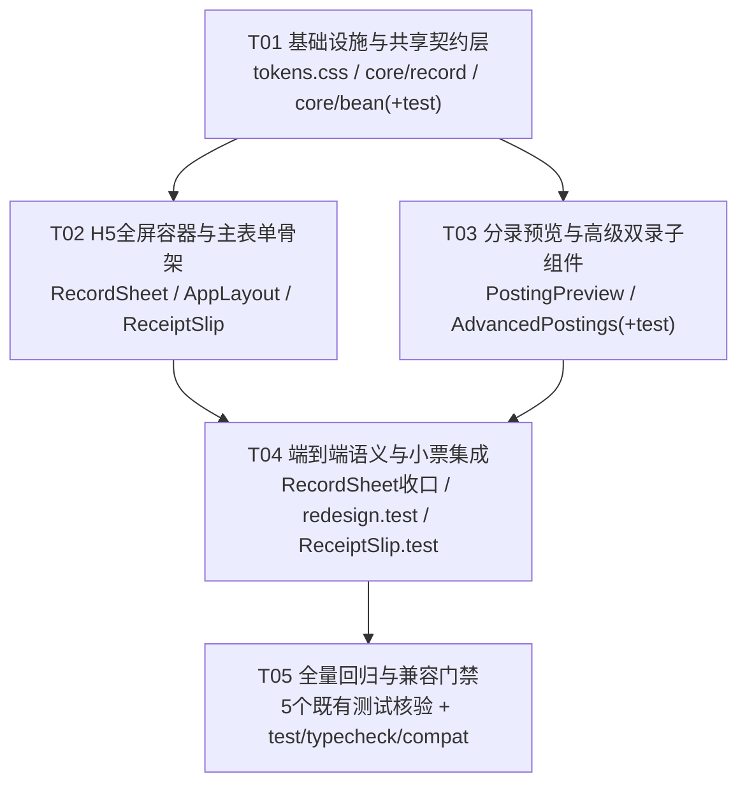

# FamBean「记一笔」最终稿全量落地 · 系统设计与任务分解

> 架构师：高见远（Bob） · 阶段：架构设计（只做设计，不改代码 / 不 commit / 不动设计稿）
> 唯一规格源：`D:/Project/Self/FamBean/docs/prototype/record-sheet-redesign.html`（1183 行最终稿）
> 改造对象：`frontend/` 唯一 Vue 3 + Vite + TS SPA；Go 后端零改动；Vitest 2.1.9（48 文件 / 361 用例）
> 目标：把当前「底部弹窗 Sheet」形态 1:1 落地为稿内「H5 全屏暖纸账本 + Beancount 双录」形态，同时**不倒退**已拍板的产品决策与契约。

---

## Part A：系统设计

### 1. 改造方案（Implementation Approach）

#### 1.1 核心难点

| 难点 | 结论 |
|---|---|
| 稿内是单文件原生 JS + innerHTML 局部刷新，产品是 Vue 3 响应式 SFC | **不照搬**稿内 `patchAmount()/patchAdvanced()/innerHTML` 的 DOM 拼串做法；用 Vue computed 派生 `preview / balanceGroups / beanText / canSubmit`，模板声明式渲染。稿内的 `js-*` 类仅作为**选择器契约**保留，不作为更新手段。 |
| 稿内视口切换（`.vp--h5 / d390 / d360 / pc`）是评审专用 | **评审台不落地**：`.demo`、`.demo-toggle`、`MODES / VPS / defaults`、`window.__fb` 全部不进产品代码。产品只保留「移动全屏 / PC 弹窗」两种真实形态。 |
| `100dvh` / `inset:0` 会触发 `npm run compat` 门禁 | CSS 用 `height:100vh; height:var(--vvh,100vh)` 两段兜底；`--vvh` 由 JS 从 `visualViewport.height` 写成 px。`inset:0` 展开为 `top/right/bottom/left:0`。禁用 `:has()` / `aspect-ratio` / `.at()` / `structuredClone` 等（见 §8）。 |
| 稿内金额用 `parseFloat` + 整数分运算，产品铁律是 `core/Money`（decimal.js） | **禁止移植**稿内的 `cents()/amountValue()/signed()` 裸浮点实现；生产代码一律 `Money.from(...).toString()`（定点两位、无指数、无千分位），导出片段再按 `beanAmt()` 规则输出纯数字。 |
| 稿内账户表（CATS/ASSETS）是示意 | **必须读真实数据源** `accountApi.list()` 的 `AccountView.name`（ASCII 导出名）/`display_name`（中文）/`type`/`parent_uuid`/`commodity_restriction`/`sort_order`。零硬编码示例账户。 |
| 导出片段要与 `internal/export/beancount.go` 逐字一致 | 新增纯函数层 `core/bean.ts`，单测固定期望串与 Go 侧 `fmt.Fprintf("%s %s %q\n") + tags: %q + "  %s %s %s"` 对齐；权威导出仍是后端 `GET /api/export`，前端片段仅预览。 |

#### 1.2 形态切换策略（产品真实规则）

**推荐规则（标注：待老板确认）**：

- `< 1024px`（手机、平板竖屏）→ **H5 全屏页**：`.rs-mask` 铺满视口、`.rs-panel` 圆角 0、高度 `var(--vvh)`、带 `safe-area-inset-top/bottom`、唯一滚动区 `.rs-body`、键盘避让 `body.kbd-open`、矮屏媒体查询压缩。
- `>= 1024px` → **居中 460px 弹窗**（稿 `.vp--pc .rs-panel{width:460px;max-width:92%;height:88%;border-radius:18px}`）。

**依据**：
1. 现有 `tokens.css` 与 `AppLayout.vue` 已统一以 `1024` 作为 PC/移动分界；沿用可保证全应用 IA 一致，不引入第二套断点。
2. 现有 `RecordSheet.vue` 的 `variant='auto'` 已经按 1024 切换，只是移动侧是 Sheet；本次仅把移动侧从「底部 Sheet」改为「全屏页」，断点语义不变。
3. 稿内 H5 真机全屏是默认主形态（`<div class="vp vp--h5">`），`d390/d360` 设备框与 `pc` 画布明确属于评审舞台（`.vp--d390::before` 画刘海、`body.is-review`）。

**实现口径**：
- 形态由 **CSS media query** 决定（不是 JS 探测设备），`.rs-mask--auto` 默认全屏，`@media (min-width:1024px)` 改居中弹窗。这样 jsdom 测试无需 `matchMedia` mock，SSR/首帧无闪烁。
- 保留 `variant?: 'auto' | 'dialog' | 'sheet' | 'fullscreen'` prop 作为显式覆盖（`sheet` 仅供旧调用/测试兼容，产品入口一律 `auto`）。**不新增 npm 依赖**。
- `--vvh` 是唯一需要 JS 的视口量：`onMounted` 立即 `syncVv()`，`visualViewport.resize` + `window.resize` 监听，`onUnmounted` 清理并恢复内联变量。CSS 始终保留 `100vh` 兜底。
- **路由影响**：当前 RecordSheet 是 store 驱动的浮层（非路由页）。全屏后安卓物理返回键/浏览器后退会直接离开页面。本期**推荐保持浮层语义**（不改路由），把返回键行为列为待明确事项（见 §9-R3）；若需拦截，应单独引入 `history.pushState` + `popstate` 或 `/record` 路由，需老板拍板。

#### 1.3 架构模式与分层

```
展示层  RecordSheet.vue（单实例/形态切换/事件与生命周期）
        ├─ PostingPreview.vue（分录预览 + 配平 chip + bean <details>）
        ├─ AdvancedPostings.vue（双录行 + 增删 + auto-balance + 配平检查卡）
        └─ ReceiptSlip.vue（纸面小票，纯展示，绿/琥珀双态）
状态层  Pinia：recordSheet（isOpen/editingTxn/savedEpoch）+ session（ledgerId/commodity/权限）
纯函数层 core/record.ts（分录推导、配平、展示视图） + core/bean.ts（导出片段） + core/Money.ts（定点）
接入层  api/client.ts（accountApi / commodityApi / transactionApi / 幂等键）
持久化  core/storage.ts（按账本命名空间的草稿 / 默认账户，不含凭据）
样式层  styles/tokens.css（唯一色板与视口变量源）+ 组件 scoped（结构）
```

**原则**：`core/*` 零 Vue/DOM 依赖、可独立单测；所有金额运算走 `Money`；所有色值只在 `tokens.css` 声明。

---

### 2. 文件列表（File List）

> 相对 `D:/Project/Self/FamBean/`；「改」= 修改现有，「新增」= 新建。**不改** `internal/**`、`docs/prototype/**`、`package.json`、`vite.config.ts`、`tsconfig.json`。

| 路径 | 职责 | 性质 |
|---|---|---|
| `frontend/src/styles/tokens.css` | 全局色板从「科技蓝」切到「暖纸账本」：墨绿主色/印章红/暖米底/纸纹/衬线大数/字体族/阴影/soft 语义色；新增 `--fb-seal*`、`--fb-brand*`、`--fb-ink-deep`、`--fb-font-ledger`、`--fb-font-mono`、`--fb-paper-edge`、`--fb-mask*`、`--fb-shadow-panel/dock/brand/tab/key/inset`、`--kb-h`、`--safe-t/b`、`--vvh:100vh`（兜底）；调深 `--fb-sub`/`--fb-paper-sub` 到 ≥4.5:1 | 改 |
| `frontend/src/core/record.ts` | `RecordForm` 增 `flag: TxnFlag`；新增 `AdvancedRow`、`PostingView`、`BalanceGroup` 类型；新增 `balanceGroups(postings)`（按 commodity 分组 sum/pos/neg/rows/balanced）、`buildPostingViews(postings, accounts)`（挂真实导出名、借贷徽标）；**保留** `buildPostings` / `balanceDiffByCommodity` / `accountLabel` 等既有 API 不变 | 改 |
| `frontend/src/core/bean.ts` | 新增纯函数：`beanAmount(amount)`（Money→无千分位纯数字）、`joinTags(tags)`（trim/去空/空格拼接，等价 Go `joinTags`）、`buildBeanSnippet({date,flag,description,tags,postings})` | 新增 |
| `frontend/src/core/bean.test.ts` | 逐字对齐 `internal/export/beancount.go` 的快照测试：中文标签走 `tags: "..."`、双引号转义、`2,680.00` 禁止出现、多币种、flag 两态 | 新增 |
| `frontend/src/components/RecordSheet.vue` | 主组件一次性改造：形态/结构/CSS/键盘/键盘避让/`--vvh`/真实导出名/flag 控件/分录预览接入/高级态接入/提交 payload 带 flag/草稿兼容/小票 bean 快照。保留全部既有测试选择器与数据流 | 改 |
| `frontend/src/components/PostingPreview.vue` | 分录预览卡：借贷徽标 + 真实导出名小字 + 正负等宽金额 + 按 commodity 配平 chip + `<details>` bean 片段 + bean-check 说明 | 新增 |
| `frontend/src/components/AdvancedPostings.vue` | 高级双录：逐行账户/金额/币种（4 列：账户 + 金额 + 币种 + ✕）、增删行、`auto-balance` 按差额补一行、配平检查卡（借/贷/差额按币种）、返回简化模式入口 | 新增 |
| `frontend/src/components/AdvancedPostings.test.ts` | 组件级单测：配平/不平衡差额/`auto-balance` 只补一行且账户留空禁保存/多币种各自配平 | 新增 |
| `frontend/src/components/ReceiptSlip.vue` | 去内部硬编码色（改引 `--fb-paper-*` / `--fb-seal-*` / `--fb-warn-*`）；新增 `bean?: string` 片段区；绿印章/琥珀印章双态 token 化；保留 shared 用法（交易详情页） | 改 |
| `frontend/src/components/AppLayout.vue` | 最小适配：`<RecordSheet v-if="sheet.isOpen" @close="sheet.close()" />` 容器在全屏态的层级/滚动链隔离（`.layout` overscroll、`z-index` 与底栏遮挡核验），不改 store 契约 | 改 |
| `frontend/src/components/RecordSheet.redesign.test.ts` | 新形态回归：全屏/弹窗容器类、真实导出名渲染、flag 透传、bean 片段、配平禁保存、主操作唯一、无「取消」、`--vvh`/kbd-open 的生命周期清理 | 新增 |
| `frontend/src/components/ReceiptSlip.test.ts` | 小票 bean 区、tone 双态、感谢语文案 | 新增 |
| `frontend/src/components/RecordSheet.advanced.test.ts` | 核验既有断言继续通过；仅当选择器重命名导致失败时做最小适配（断言不得降低） | 核验/必要改 |
| `frontend/src/components/RecordSheet.idempotency.test.ts` | 同上（幂等键生命周期 + disabled 按钮用原生 `dispatchEvent` 的anti-空洞断言） | 核验/必要改 |
| `frontend/src/components/RecordSheet.iosFont.test.ts` | 同上（源码文本断言：`.rs-body input/select/textarea` 与 `.rs-select` 必须 16px） | 核验/必要改 |
| `frontend/src/components/RecordSheet.defaults.test.ts` | 同上（默认账户预选/失效回退/关户过滤） | 核验/必要改 |
| `frontend/src/views/TransactionDetailView.s6.test.ts` | 同上（编辑态 PATCH 冲正+新建、固定文案、`.rs-foot button.fb-btn-primary` 选择器） | 核验/必要改 |

---

### 3. 数据结构与接口（Data Structures & Interfaces）

#### 3.1 真实数据源与字段映射

| 用途 | 来源 | 字段映射 | 禁止 |
|---|---|---|---|
| 分类九宫格 / 完整列表 | `accountApi.list()` → `accounts.value` 过滤 `type === 'Expenses' \| 'Income'` 且 `!close_date`，按 `sort_order` 升序取前 9 | `id` → 绑定值；`name` → 真实导出名小字；`display_name` → 中文主文案（`accountLabel()` 已实现优先 display_name）；`icon` → 图标；`parent_uuid` / `name` 冒号层级 → 三级账户标识 | 硬编码稿内 `CATS` 数组 |
| 资金账户 / 转出 / 转入 | `recordFundAccounts(accounts.value)`（未关闭 Assets/Liabilities） | 同上；`balances[defaultCommodity]` → 余额（`privacy.enabled` 时 `••••`） | 硬编码 `ASSETS` |
| 高级双录账户下拉 | `openAccounts`（全部未关闭账户，含 Equity/Liabilities） | `value=account.id`，label=`display_name · name` | 只给 Assets |
| 币种下拉 | `commodityApi.list()` → `CommodityView.symbol[]`；失败时兜底 `[session.defaultCommodity, 'CNY']` 去重 | `commodity_restriction` 优先，其次账户 `balances` 的 key，最后 `defaultCommodity` | 硬编码 `['CNY','USD']` |
| flag | 表单字段 `form.flag: TxnFlag` | 新建默认 `'*'`；编辑态从 `editingTxn.flag` 预填；写入 `CreateTransactionRequest.flag`；预览片段首行使用 | 继续写死 `'*'` |

> 账户名合法性由后端 seed 保证（`internal/seed/accounts.go`：五大 ASCII 根 + `:` 分层）；前端只透传 `account.name`，不做翻译、不做二次拼装。

#### 3.2 关键类型（详见 `docs/class-diagram.mermaid`）

```ts
// core/record.ts（新增/扩展部分）
export type TxnFlag = '*' | '!'            // 复用 api/types，不重复定义
export interface RecordForm {
  // ...既有字段不变
  flag: TxnFlag                            // 新增：* 已完成 / ! 待核
}
export interface AdvancedRow {
  accountId: number | null
  amount: string                           // 定点字符串（带符号）
  commodity: string                        // 由账户带出，可下拉覆盖
}
export interface PostingView {
  account: AccountView
  name: string                             // account.name，真实导出名
  label: string                            // display_name，中文
  amount: string                           // 定点，带符号
  commodity: string
  isDebit: boolean                         // amount > 0；仅 UI 徽标
}
export interface BalanceGroup {
  commodity: string; sum: string; pos: string; neg: string
  rows: number; balanced: boolean          // sum===0 && rows>=2
}
```

#### 3.3 配平口径（按 commodity 分组）

- `balanceGroups(postings)` 按 `commodity` 分桶，用 `Money` 定点累加 `sum / pos / neg` 与行数。
- 规则：**同币种 `sum = 0` 且该币种分录数 `>= 2`**；全部币种通过 + 至少 2 行 + 每行账户已选且金额非 0 → `canSubmit = true`。
- `auto-balance`：取第一个不平币种的 `diff`，`rows.push({ accountId: null, amount: (-diff).toString(), commodity: k })`；**账户留空**，用户必须选择后才能保存（稿内口径一致）。
- 保留 `balanceDiffByCommodity()` 供既有测试与提交路径使用，二者共用同一 `Money` 口径；不重复实现。

#### 3.4 导出片段在前端如何生成

- **新增** `core/bean.ts` 纯函数（不复用后端 Go 代码——跨语言无法直接复用；也不能调用 `GET /api/export` 生成片段，因为交易尚未落库）。用单测把 Go 侧格式「钉死」为契约，避免漂移。
- 格式（逐字对齐 `internal/export/beancount.go:246-258`）：

```
2026-11-16 * "超市采购"
  tags: "日常 孩子"
  Assets:Alipay -128.50 CNY
  Expenses:Food 128.50 CNY
```

  - 第一行：`${date} ${flag} "${desc.replace(/"/g,'\\"')}"`
  - 第二行（tags 非空）：`  tags: "${joinTags(tags).replace(/"/g,'\\"')}"`，中文标签走元数据行，**不是 `#tag`**；
  - 后续每行：`  ${account.name} ${beanAmount(amount)} ${commodity}`，金额**禁止千分位**（bean-check 不接受 `2,680.00`）；
  - `beanAmount(amount)` = `Money.from(amount).isNegative() ? '-' + abs.toString() : abs.toString()`，输出固定两位。
- **权威导出仍是后端** `GET /api/export`；前端片段只做「对照 bean-check」的折叠预览与小票展示，不参与提交载荷。
- 精度风险：后端按 `commodity.precision` 格式化，前端固定 2 位；对 precision≠2 的币种可能不一致（见 §9-R4）。

#### 3.5 提交载荷（不倒退）

```ts
const payload: CreateTransactionRequest = {
  date: form.date,
  flag: form.flag,                        // 新增：由用户编辑
  description: ..., tags: form.tags.slice(),
  postings: drafts.map(p => ({
    account_id: p.accountId, commodity: p.commodity, amount: p.amount,
  })),
}
```
- 新建：`transactionApi.create(payload, idempotencyKey)`；payload JSON 快照决定键复用/换新；409 换键；`network_error` 走 `saveOffline()`（account_id → account_uuid）。
- 编辑：`transactionApi.update(uuid, payload)`（PATCH = 冲正 + 新建），**仅在线、无幂等键、无离线兜底**，固定文案「修改需联网，请恢复网络后重试」。
- 小票快照 `ReceiptSnapshot` 增 `bean: string`，四态 `saved/idempotent/offline/updated` 映射印章 `green/blue/amber/green`。

---

### 4. 程序流程（Program Call Flow）

完整时序见 `docs/sequence-diagram.mermaid`，关键链路摘要：

1. **渲染**：`AppLayout` → store `open()/openEdit()` → `RecordSheet` mount → `restoreDraft` → `accountApi.list()` + `commodityApi.list()` → 编辑预填 / 默认账户预选 → `buildPostings` → `balanceGroups` + `buildPostingViews` → `buildBeanSnippet` → `canSubmit` → 渲染。
2. **输入**：`pressKey()` 改写 `amountExpression` → Vue computed 链自动派生金额/分录/配平/bean → `PostingPreview` props 更新 → `canSubmit` 驱动「保存/再记」与全宽保存条的 disabled。分类九宫格与完整列表写**同一字段** `form.categoryAccountId`，并回显「已选 + 真实导出名」。
3. **高级**：`toggleAdvanced` 用简化态分录预填 → 逐行编辑（账户带出币种）→ `add/remove/auto-balance` → `balanceGroups` → 配平检查卡 → 唯一全宽保存条。
4. **保存**：守门 `canSubmit` → 构造 payload（含 flag）→ 幂等/离线/冲正分支 → `buildReceipt`（含 bean）→ `showSuccess` → `ReceiptSlip` 绿/琥珀印章 → 再记/复制/返回。
5. **形态与键盘避让**：CSS media query 决定全屏/弹窗；JS `--vvh` 由 `visualViewport.height` 同步；`focusin/focusout(input.inp-text)` 切 `body.kbd-open`；`onUnmounted` 移除监听、清除 `kbd-open`、恢复 `--vvh`。
6. **草稿**：`watch(() => JSON.stringify(snapshot()))` → `writeDraft(ledgerId, snapshot)`；编辑态与成功态不写草稿。`snapshot()` 必须包含 `flag`，否则刷新后 flag 丢失。

---

### 5. Anything UNCLEAR（假设与待明确）

见 §9「风险与待明确事项」。核心假设：**全站色板统一切换**；**保留浮层非路由**；**九宫格不足 9 个时按实际数量渲染**；**标签兼容空格/逗号两种输入、导出统一空格**。

---

## Part B：任务分解

### 6. Required Packages（依赖声明）

**不新增任何 npm 依赖**（老板明确要求；现有依赖足够）：

```
- vue@^3.5.0            : 组合式 API + computed 派生链（已装）
- pinia@^2.3.0          : recordSheet / session 状态（已装）
- vue-router@^4.5.0     : 布局与页面（已装，本次不改路由）
- decimal.js@^10.4.3    : core/Money 定点金额（已装）
- vitest@^2.1.0         : 单测（实际 2.1.9，已装）
- @vue/test-utils@^2.4.6: 组件测试（实际 2.5.1，已装）
```
> 说明：任务 T01 作为「项目基础设施」任务，在本次**改造场景**下等价映射为「全局 token + 共享纯函数契约 + 契约测试」；`vite.config.ts`、`tsconfig.json`、`package.json` 经核实**无需改动**，保持 `build.target: 'es2015'` 与 es2020 门禁基线不变。

---

### 7. Task List（有序，≤5，按依赖编号）

#### T01 · 基础设施与共享契约层
- **优先级**：P0 · **依赖**：无
- **源文件**：
  - `frontend/src/styles/tokens.css`（改）
  - `frontend/src/core/record.ts`（改）
  - `frontend/src/core/bean.ts`（新增）
  - `frontend/src/core/bean.test.ts`（新增）
- **要点**：色板全量替换（§8 命名表）；`RecordForm.flag` / `AdvancedRow` / `PostingView` / `BalanceGroup`；`balanceGroups()` / `buildPostingViews()`；`beanAmount/joinTags/buildBeanSnippet`；保留既有导出 API。
- **验收**：`npx vitest run core/bean.test.ts core/record.test.ts core/balance.test.ts` 全绿；`npm run compat` 未因新 token 命中禁用 CSS（尤其 `dvh`/`inset:`）；`--vvh` 兜底值为 `100vh` 而非 `100dvh`。

#### T02 · H5 全屏容器与主表单骨架
- **优先级**：P0 · **依赖**：T01
- **源文件**：
  - `frontend/src/components/RecordSheet.vue`（改：结构 + 样式 + 生命周期 + 入口接线）
  - `frontend/src/components/AppLayout.vue`（改：层级/滚动隔离最小适配）
  - `frontend/src/components/ReceiptSlip.vue`（改：token 化 + `bean` prop + 双态印章）
- **要点**：形态切换（CSS 变量 + media query）、`--vvh` 同步与清理、`body.kbd-open`、43px 大数/5列72px 分类格/48px 键位、4列键位契约、主操作互斥唯一、无「取消」、flag 控件、真实导出名展示、草稿含 flag。接入 T03 的两个子组件（先按约定 props 留位）。
- **验收**：`RecordSheet.iosFont.test.ts` / `.defaults.test.ts` / `.idempotency.test.ts` / `TransactionDetailView.s6.test.ts` 全绿；`npx vitest run` 中 RecordSheet 相关用例无一倒退。

#### T03 · 分录预览与高级双录子组件
- **优先级**：P1 · **依赖**：T01（与 T02 可并行，T02 预留 props 契约）
- **源文件**：
  - `frontend/src/components/PostingPreview.vue`（新增）
  - `frontend/src/components/AdvancedPostings.vue`（新增）
  - `frontend/src/components/AdvancedPostings.test.ts`（新增）
- **要点**：借贷徽标、正负等宽金额、按 commodity 配平 chip、不平衡差额与禁保存、`auto-balance` 补行（账户留空）、增删行、配平检查卡、`<details>` bean 片段；所有文案/类名遵循 §8。
- **验收**：组件独立测试全绿；`auto-balance` 后 `canSubmit=false` 且保存 disabled；多币种分别配平；`bean` 片段与 T01 生成结果逐字一致。

#### T04 · 端到端语义与小票集成
- **优先级**：P1 · **依赖**：T01、T02、T03（唯一汇聚任务）
- **源文件**：
  - `frontend/src/components/RecordSheet.vue`（改：flag 透传、bean 快照、T02/T03 联调收口）
  - `frontend/src/components/RecordSheet.redesign.test.ts`（新增）
  - `frontend/src/components/ReceiptSlip.test.ts`（新增）
- **要点**：flag 写入 create/update 载荷并经快照回显；`ReceiptSnapshot.bean` 传入小票；编辑冲正提示；绿/琥珀双态；再记/复制/返回；全量新形态回归断言。
- **验收**：新增测试全绿；提交 payload 中 `flag` 随控件变化；小票 bean 区与折叠片段一致；既有 361 用例无回归。

#### T05 · 全量回归与兼容门禁
- **优先级**：P1 · **依赖**：T04
- **源文件**：
  - `frontend/src/components/RecordSheet.advanced.test.ts`（核验/必要最小适配）
  - `frontend/src/components/RecordSheet.idempotency.test.ts`（核验/必要最小适配）
  - `frontend/src/components/RecordSheet.iosFont.test.ts`（核验/必要最小适配）
  - `frontend/src/components/RecordSheet.defaults.test.ts`（核验/必要最小适配）
  - `frontend/src/views/TransactionDetailView.s6.test.ts`（核验/必要最小适配）
- **要点**：跑全量 48 文件 / 361 用例 + `npm run typecheck` + `npm run compat`；核对 §8 的「避坑清单」逐条落地；选择器若重命名必须同步测试，**断言不得降低**。
- **验收**：`npm test` 全绿（≥361 用例，新增用例只增不减）；`npm run typecheck` 无错；`npm run compat` PASS 且 `dist/legacy/` 快照未变；无新增 npm 依赖。

#### 任务依赖图



---

### 8. Shared Knowledge（跨文件约定与避坑）

#### 8.1 CSS token 命名（稿 `:root` → `tokens.css` 映射）

| 稿内变量 | 落地 token（值） | 说明 |
|---|---|---|
| `--fb-blue` | `#2f5d4e` | 墨绿主色；**全局覆盖**旧 `#3b6ef6` |
| `--fb-green` / `--fb-warn` / `--fb-danger` | `#3f7d5c` / `#c8811e` / `#b4463c` | 语义色 |
| `--fb-seal` / `--fb-seal-soft` | `#c1443b` / `#f6e7e2` | 印章红（新增） |
| `--fb-ink-deep` / `--fb-brand` / `--fb-brand-soft` / `--fb-brand-line` | `#1f332c` / `var(--fb-blue)` / `#e6efe8` / `#c3d8cb` | 标题/主操作 |
| `--fb-bg` / `--fb-card` / `--fb-ink` / `--fb-sub` | `#f2eee5` / `#fdfbf4` / `#242b26` / `#5f5b50` | 暖米底、纸面；`--fb-sub` 调深至 ≥4.5:1 |
| `--fb-line` / `--fb-line-strong` / `--fb-soft` | `#ded7c6` / `#c9c3b2` / `#f5f0e4` | 分隔线/浅底 |
| `--fb-hero-gradient` | `linear-gradient(150deg,#1f332c 0%,#2f5d4e 58%,#3f735e 100%)` | 替换科技蓝渐变 |
| `--fb-paper*` | `#fdfbf4` / `#262b26` / `#625e53` / `#c9c3b2` / `#ded7c6` | 小票；`--fb-paper-sub` 调深 |
| `--fb-font-ledger` / `--fb-font-mono` | `Georgia,'Times New Roman',serif` / `'SFMono-Regular',Consolas,...` | 账页大数 / 分录等宽 |
| `--fb-mask` / `--fb-mask-strong` | `rgba(42,36,26,.44)` / `rgba(32,28,20,.64)` | 暖色遮罩 |
| `--kb-h` / `--safe-t/b` / `--vvh` | `clamp(40px,6.4vh,48px)` / `env(safe-area-inset-*)` / `100vh`（JS 写 px） | **禁止 `100dvh` 字面量** |
| soft 语义 | `--fb-green-soft:#e6efe3`、`--fb-warn-soft:#f9edd7`、`--fb-danger-soft:#f7e7e3`、`--fb-blue-soft`→alias brand-soft | 与旧 `--fb-*-soft` 平滑迁移 |

> 所有组件只 `var(--fb-*)` 引用；`ReceiptSlip.vue` 内的 `#ba800c/#8a6100/#1f7a52/#d9d2bf/#6b6353/#b9b2a1/#ddd5c2/#a29a87` 等硬编码必须改为 token。

#### 8.2 事件 / 数据流约定

- **单一数据源**：`form`（Reactive `RecordForm`）+ `rows`（`AdvancedRow[]`）+ `accounts/commodities`；所有 UI 写操作只改这些对象，禁止稿内 `state.xxx` + `innerHTML` 模式。
- **派生链**：`form/rows` → `buildPostings`/`buildAdvancedPostings` → `balanceGroups` → `PostingView[]` → `beanText` → `canSubmit` → `disabled`。不得在多处重复计算配平。
- **DOM 类契约**（测试与稿内一致）：
  - 容器：`.rs-mask` / `.rs-mask--auto|dialog|sheet|fullscreen` / `.rs-mask--receipt`；`.rs-panel` / `.rs-panel--receipt`
  - 主操作：简化态键盘 `.rs-key` / `.rs-key--save` / `.rs-key--again` / `.rs-key--op`；高级态 `.rs-foot button.fb-btn-primary`（**既有测试 hard selector，不可改**）
  - 分类：`.rs-cat` / `.rs-cat.on` / `.rs-cat__icon` / `.rs-cat__name`；完整列表 `.rs-select`
  - 双录行：`.rs-adv-row` + `[data-rf="acc"|"amt"|"cur"]`；增删 `[data-act="add-row"|"remove-row"|"auto-balance"]`；配平检查 `.js-check`
  - 局部刷新锚点（沿用稿内命名）：`.js-amount` / `.js-preview` / `.js-bal` / `.js-bal-tag` / `.js-bean` / `.js-check` / `.js-advrows` / `.js-save` / `.js-cat-chip` / `.js-cat-select` / `.js-rail-amt` / `.js-rail-txt` / `.js-foot-note`
  - data 属性：`data-act` / `data-tab` / `data-cat` / `data-row` / `data-rf` / `data-field` / `data-key`
- **键位契约**：`7 8 9 ⌫ / 4 5 6 ＋ / 1 2 3 － / . 0 再记 保存`（顺序不可变）；「再记」次要样式，「保存」实心主色，二者均受 `canSubmit` 守门。
- **主操作全局唯一**：简化态**不渲染** `.rs-foot`；高级/编辑态**不渲染** `.rs-keyboard`。无「取消」按钮，关闭只靠 `✕` + 点遮罩自身（`.rs-mask @click.self`）。
- **标签分隔符**：UI 兼容空格与中英文逗号（`[\s,，]+`），导出统一单空格 `tags: "..."`；placeholder 明示。

#### 8.3 避坑清单（QA 历史发现 / 兼容基线）

1. **VTU 2.5.1 的 `trigger()` 对 disabled 按钮不派发事件**（内部 `isDisabled` 短路）。写「禁用时不发请求」断言必须用原生 `saveKey.element.dispatchEvent(new MouseEvent('click',{bubbles:true}))` 强制走 `pressKey()` 守门，否则是空洞断言（见 `RecordSheet.idempotency.test.ts:265-274`）。
2. **iOS 16px 防缩放**：`RecordSheet.iosFont.test.ts` 是**源码文本断言**（去注释后按精确选择器找规则体）。必须保留 `.rs-body input` / `.rs-body select` / `.rs-body textarea` 三条 16px 规则与 `.rs-select{font-size:16px}`；新增高级态窄行控件也在 `.rs-body` 内即可自动覆盖。
3. **Safari 14.1 禁用清单**（`scripts/compat.mjs` 会扫产物）：
   - JS：`structuredClone` / `crypto.randomUUID` / `.at()` / `findLast(Index)` / `Object.hasOwn` / `showModal` / `BroadcastChannel` / `navigator.locks` / `OffscreenCanvas` / WebAssembly/WebGL。
   - CSS：`aspect-ratio` / `:has()` / **`dvh`** / **`inset:`**。稿内 `100dvh` 与 `inset:0` 必须改写（见 §1.1）。
   - flex `gap`：稿内 `.d-btns/.bal-bar/.rs-keyboard` 用到；现有代码已有 flex gap 且 compat 通过，但**不新增** flex gap（用 grid gap 或 margin），降低 Safari 14.1 风险。
4. **`100vh` 兜底**：`--vvh` 由 JS 在 mounted 后才写 px；CSS 先写 `height:100vh` 再写 `height:var(--vvh,100vh)`，避免首帧/无 JS 高度为 0。
5. **Money 铁律**：生产代码禁 `parseFloat`/`Math.abs`/裸 `+ - * /` 算金额；稿内 `cents()/amountValue()` 仅供演示，**严禁移植**。导出金额必须无千分位。
6. **编辑态文案**：既有测试断言包含「原交易将被冲正」「修改需联网，请恢复网络后重试」，且断言**不出现**「已保存在本机」；冲正提示只在线。
7. **副作用清理**：`body.kbd-open`、`document.documentElement.style.setProperty('--vvh')`、`visualViewport/window resize` 监听必须在 `onUnmounted` 清理，否则多实例/切账本残留。
8. **账户数据**：稿内 `ALL_ACCOUNTS` 含示例账户，产品里若 `accountApi.list()` 为空应显示空态而非回退示例数据。
9. **不相交职责**：`core/*` 不 import Vue / api / store；`api/types.ts` 的 `TxnFlag` 是唯一 flag 类型源，不要在 `core/record.ts` 重复定义。
10. **测试文件数**：`vitest.config` 中 `fileParallelism:false`，新增测试文件会延长串行时间但保证稳定；不要为了速度改并行。

---

### 9. 风险与待明确事项（需老板拍板 / 工程师核实）

| ID | 事项 | 影响 | 建议 / 默认假设 |
|---|---|---|---|
| R1 | **全站换肤 vs 仅记一笔作用域** | 改 `tokens.css` 的 `--fb-blue` 等会改变所有页面配色；若只改组件 scoped，则与稿内「全局色板」不一致 | 推荐全局覆盖（稿即 `:root`），工程师需在 T05 目视核验全部页面；若老板只要局部，改为在 `.rs-mask` 上声明同名词变量覆盖 |
| R2 | **真实账户数据源 vs 稿内示意账户** | 稿内 10 个支出/9 个收入/4 个资产是示意；真实账本可能不足 9 个分类、含三级账户与自定义币种 | 以 `accountApi.list()` 为准；九宫格按实际数量（≤9）渲染并给空态；三级账户靠 `parent_uuid`/冒号层级；**需工程师核实** `sort_order` 在列表响应中的实际取值 |
| R3 | **全屏形态对路由 / 返回键的影响** | 当前是 store 浮层非路由页；安卓物理返回/浏览器后退会离开页面而非关闭表单；PWA standalone 状态栏与 safe-area 需真机验证 | 本期默认保持浮层语义（不改路由）；**待拍板**是否引入 `/record` 路由或 `history.pushState` + `popstate` 拦截返回关闭 |
| R4 | **多精度币种导出一致性** | 后端 `formatAmount(p.amount, precOf(commodity))` 按币种精度（如 JPY 0 位）格式化，前端 `Money.toString()` 固定 2 位；非 2 位币种预览片段可能与权威导出不同 | 本期默认 2 位（与现有产品口径一致）；**待确认**是否读取 `CommodityView.precision` 在 `beanAmount()` 中按精度输出；若是，需扩展 `core/Money` 或新增 `formatByPrecision` |
| R5 | **flag 可编辑的业务边界** | 新建是否允许 `!`（待核）；编辑态冲正后新交易的 flag 应沿用用户选择还是强制 `!` | 默认：新建允许两态，编辑态预填原交易 flag 且用户可改；**待确认**冲正交易本身 flag 由后端决定，前端不干预 |
| R6 | **标签分隔符口径** | 稿内空格分隔，现网逗号分隔；中文标签含空格时歧义 | 默认兼容 `[\s,，]+`，导出统一空格；**待确认**是否保留纯逗号输入以维持旧习惯 |
| R7 | **`auto-balance` 补行账户为空** | 稿内补行后账户仍需选择 → 保存保持禁用；部分用户可能期望自动选「Equity:Opening-Balances」 | 默认严格按稿：留空 + 禁保存；**待确认**是否提供「自动选冲抵账户」快捷 |
| R8 | **`--vvh` 首帧与 Chrome 地址栏** | JS 写 px 前用 `100vh`，移动端地址栏收缩时可能短暂溢出/留白 | 默认双段回退 + resize 同步；**待工程师真机核实** `visualViewport.resize` 触发频率与 `body.kbd-open` 叠加是否抖动 |
| R9 | **测试选择器重命名** | 若把 `.rs-cat` 结构或 `.rs-foot button.fb-btn-primary` 改名，5 个既有测试文件会红 | 硬约束：这些选择器不可改；若必须改，T05 同步更新断言且不得降低覆盖 |
| R10 | **评审台误入产品代码** | 直接复制稿内 `<script>` 会引入 `parseFloat`/`cents` 裸浮点与 `dvh`/`inset`，触发 compat 失败且违反 Money 铁律 | 明确只抄「结构/样式/文案/选择器契约」，脚本逻辑用 Vue 重写；T05 用 `npm run compat` 兜底 |

---

## 交付物索引

- 本文档：`docs/system_design.md`
- 类图：`docs/class-diagram.mermaid`
- 时序图：`docs/sequence-diagram.mermaid`

> 备注：本次交付未修改任何源码、未修改 `docs/prototype/record-sheet-redesign.html`、未 commit。
